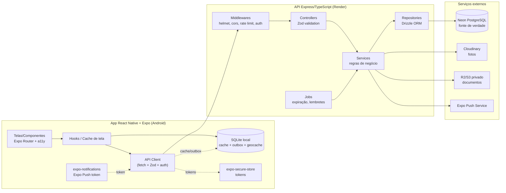

# 🗺️ Plano de Implementação (PLAN)

**Projeto:** App de Agendamento de Serviços de Beleza a Domicílio
**Versão:** 3.0 · **Última atualização:** 2026-10-29
**Fonte do escopo:** `docs/SPEC.md` (v1.3) · **Restrições:** `docs/CONSTITUTION.MD` (v1.2) · **Execução:** `docs/TASK.md`

> Este documento responde **como** entregar a SPEC. Mudanças aqui são baratas; mudanças na SPEC exigem o fluxo da Constituição (seção 1).
> **Decisão estruturante da v3.0:** arquitetura híbrida — **Neon PostgreSQL** é a fonte de verdade, uma **API Express/TypeScript no Render** é o único acesso, e o app **React Native + Expo** usa **SQLite (`expo-sqlite`) + Drizzle** como cache/outbox. Ver SPEC §2.4 e Constituição C13–C17.

---

## 1. Premissas a Validar (decisões tomadas como provisórias)

| # | Premissa | Decisão provisória | Validar em |
|---|----------|--------------------|------------|
| A1 | Plataforma mobile | **React Native + Expo (TypeScript)**, alvo Android (RNF04) | Marco M0 |
| A2 | Banco remoto | **Neon PostgreSQL** (serverless, branch por ambiente/PR) | Marco M0 |
| A3 | API | **Express + TypeScript** no **Render**; `DATABASE_URL` só no servidor | Marco M0 |
| A4 | ORM remoto | **Drizzle ORM** + `drizzle-orm/node-postgres` + `pg` Pool; migrações com **`drizzle-kit`** | Marco M0 |
| A5 | Cache local | **`expo-sqlite` + `drizzle-orm/expo-sqlite`**; schema/migrações com `drizzle-kit` | Marco M0 |
| A6 | Validação/contratos | **Zod** compartilhado em `packages/shared`; OpenAPI gerado/resumido no PLAN | Marco M0 |
| A7 | Autenticação | **Server-side**: e-mail/senha (Argon2id ou bcrypt), **JWT access + refresh rotativo**; sessão em `expo-secure-store` | Marco M1 |
| A8 | Geolocalização | `expo-location` + **haversine** no servidor (fonte de verdade) e no app (prévia); cache local de geocodificação | Marco M3 |
| A9 | Notificações | **Expo Push** (`expo-notifications` + Expo Push Service) + fallback local | Marco M5 |
| A10 | Arquivos | Fotos de perfil/portfólio no **Cloudinary** (free tier); documentos sensíveis em **bucket privado R2/S3** com URL assinada | Marco M2 |
| A11 | Navegação/estado | **Expo Router** + React Context/hooks + cliente de API tipado; sem lib global pesada | Marco M0 |
| A12 | Testes | **Vitest** (API/shared), **Jest + jest-expo + RNTL** (app), **Maestro** (E2E), **k6** (carga), **better-sqlite3** (SQLite em testes), Postgres de teste/Neon branch | Marco M0 |
| A13 | Deploy | Render (API) + Neon (DB) + EAS (Android); CI GitHub Actions | Marco M0 |

> Se A2–A4 mudarem, a SPEC funcional continua válida; muda a infraestrutura. **Entretanto, C13–C15 tornam Neon + API + SQLite-cache restrições atuais.**

## 2. Arquitetura



**Regras de ouro (Constituição P4/P8–P11):**
- **Telas** só renderizam/capturam entrada. **Zero regra de negócio, zero SQL e zero acesso direto ao Neon.**
- **Services (API)** concentram precificação, estados do agendamento, validação de agenda, autorização, expiração e auditoria. **Services (app)** apenas orquestram cache, outbox e chamadas.
- **Repositories** usam Drizzle e recebem `tx` para compor transações. Nenhuma query concatenada; tudo parametrizado.
- **Cálculo de distância e seleção de faixa** ficam em módulo puro compartilhado (`packages/shared/deslocamento`), testável sem banco e executado no servidor.
- **Transações no Neon** obrigatórias para: reservar agenda + criar agendamento; aceitar/recusar; expirar; cancelar; salvar faixas + auditoria.
- **App nunca confirma escrita crítica localmente**. Estado otimista é transitório e revertido em erro.
- **Migrações** (`drizzle-kit`) são versionadas, revisadas e aplicadas antes do deploy da API.

**Contratos base (DoD):**
- `packages/shared`: schemas Zod de request/response, tipos de domínio, cálculo de deslocamento, formatação de dinheiro/data.
- API: `Controller` valida com Zod → `Service` aplica regra → `Repository` persiste via Drizzle.
- `Service` retorna erros de domínio tipados (`{ code, message, details? }`), nunca stack/SQL cru.
- App: `ApiClient` centraliza base URL, tokens, refresh, timeout, retry idempotente e mapeamento de erros.
- `SyncService` do app: pull por `atualizado_em` + push da outbox com `chave_idempotencia`.

### 2.1 Contrato de API (resumo — detalhar por marco)

| Área | Endpoints principais |
|------|----------------------|
| Auth | `POST /auth/register`, `POST /auth/login`, `POST /auth/refresh`, `POST /auth/logout`, `GET /me` |
| Perfil | `PATCH /me`, `PUT /clientes/me/endereco`, `PUT /profissionais/me/atendimento` (faixas + distância), `POST /profissionais/me/documentos` (URL assinada) |
| Catálogo | `GET/POST/PATCH/DELETE /servicos`, `GET/POST/DELETE /portfolio`, `GET /profissionais`, `GET /profissionais/:id` |
| Agenda | `GET/POST/DELETE /agenda`, `GET /profissionais/:id/disponibilidade` |
| Agendamento | `POST /agendamentos` (idempotente), `POST /agendamentos/:id/aceitar`, `POST /agendamentos/:id/recusar`, `POST /agendamentos/:id/cancelar`, `POST /agendamentos/:id/concluir`, `GET /agendamentos` |
| Chat | `GET /agendamentos/:id/mensagens`, `POST /agendamentos/:id/mensagens` |
| Avaliação | `POST /agendamentos/:id/avaliacao` |
| Admin | `GET /admin/profissionais/pendentes`, `POST /admin/profissionais/:id/aprovar`, `POST /admin/profissionais/:id/reprovar` |
| Sync | `GET /sync/changes?since=...`, `POST /sync/outbox` (lote idempotente) |
| Push | `PUT /dispositivos/push-token` |

Padrões: respostas `{ data }` ou `{ error: { code, message, details } }`; paginação por cursor; `Idempotency-Key` obrigatório em escritas críticas; `401` renova via refresh uma vez.

## 3. Estrutura do Repositório (monorepo)

```
beleza-delivery/
├── apps/
│   ├── mobile/                    # Expo (React Native + TypeScript)
│   │   ├── app/                   # rotas Expo Router
│   │   │   ├── (auth)/            # login, cadastro, seleção de perfil
│   │   │   ├── (cliente)/         # busca, agendamento, histórico, chat
│   │   │   ├── (profissional)/    # agenda, serviços, faixas, solicitações
│   │   │   ├── (admin)/           # aprovação de profissionais
│   │   │   └── _layout.tsx
│   │   ├── src/
│   │   │   ├── components/        # componentes acessíveis
│   │   │   ├── features/          # UI por domínio
│   │   │   ├── api/               # ApiClient, endpoints, erros
│   │   │   ├── db/                # schema SQLite, migrations, sync, outbox
│   │   │   ├── hooks/
│   │   │   ├── services/          # orquestração local (não regra crítica)
│   │   │   ├── theme/             # contraste, tipografia ampliável
│   │   │   └── utils/
│   │   ├── assets/
│   │   └── app.json / package.json / tsconfig.json
│   └── api/                       # Express + TypeScript
│       ├── src/
│       │   ├── config/            # env (Zod), logger, constantes
│       │   ├── db/                # pool, schema Drizzle, repositories
│       │   ├── modules/           # auth, usuarios, profissionais, agenda,
│       │   │                      # agendamentos, chat, avaliacoes, admin, sync
│       │   ├── middlewares/       # auth, autorização, erros, rate limit
│       │   ├── jobs/              # expiração, lembretes
│       │   ├── app.ts / server.ts
│       │   └── routes.ts
│       ├── drizzle/               # migrations geradas (versionadas)
│       └── drizzle.config.ts
├── packages/
│   └── shared/                    # Zod contracts, tipos, deslocamento, dinheiro
├── docs/                          # fonte da verdade (SDD)
├── package.json                   # workspaces npm/pnpm
├── turbo.json (opcional) / tsconfig.base.json
└── .github/workflows/ci.yml
```

## 4. Modelo de Dados (Neon PostgreSQL — fonte de verdade)

Convenções: UUID (`gen_random_uuid()`), dinheiro **`INTEGER` centavos**, datas **`timestamptz`**, booleanos nativos, `criado_em/atualizado_em` em todas as tabelas.

```sql
CREATE EXTENSION IF NOT EXISTS "pgcrypto";
CREATE EXTENSION IF NOT EXISTS "btree_gist";

CREATE TABLE usuario (
  id           uuid PRIMARY KEY DEFAULT gen_random_uuid(),
  tipo         text NOT NULL CHECK (tipo IN ('cliente','profissional','admin')),
  email        text NOT NULL UNIQUE,
  senha_hash   text NOT NULL,
  ativo        boolean NOT NULL DEFAULT true,
  criado_em    timestamptz NOT NULL DEFAULT now(),
  atualizado_em timestamptz NOT NULL DEFAULT now(),
  excluido_em  timestamptz
);

CREATE TABLE sessao_dispositivo (
  id                 uuid PRIMARY KEY DEFAULT gen_random_uuid(),
  usuario_id         uuid NOT NULL REFERENCES usuario(id) ON DELETE CASCADE,
  refresh_token_hash text NOT NULL,
  expo_push_token    text,
  plataforma         text NOT NULL DEFAULT 'android',
  ultimo_uso_em      timestamptz NOT NULL DEFAULT now(),
  revogado_em        timestamptz
);

CREATE TABLE cliente (
  id           uuid PRIMARY KEY DEFAULT gen_random_uuid(),
  usuario_id   uuid NOT NULL UNIQUE REFERENCES usuario(id) ON DELETE CASCADE,
  nome         text NOT NULL,
  telefone     text,
  criado_em    timestamptz NOT NULL DEFAULT now(),
  atualizado_em timestamptz NOT NULL DEFAULT now()
);

CREATE TABLE endereco (
  id           uuid PRIMARY KEY DEFAULT gen_random_uuid(),
  cliente_id   uuid NOT NULL UNIQUE REFERENCES cliente(id) ON DELETE CASCADE,
  cep          text NOT NULL,
  rua          text NOT NULL,
  numero       text NOT NULL,
  complemento  text,
  bairro       text NOT NULL,
  cidade       text NOT NULL,
  latitude     double precision,
  longitude    double precision,
  atualizado_em timestamptz NOT NULL DEFAULT now()
);

CREATE TABLE profissional (
  id                  uuid PRIMARY KEY DEFAULT gen_random_uuid(),
  usuario_id          uuid NOT NULL UNIQUE REFERENCES usuario(id) ON DELETE CASCADE,
  nome                text NOT NULL,
  cpf                 text NOT NULL UNIQUE,
  telefone            text,
  foto_url            text,
  documento_chave     text,
  status_verificacao  text NOT NULL DEFAULT 'pendente'
                      CHECK (status_verificacao IN ('pendente','aprovado','reprovado')),
  endereco_ref_lat    double precision NOT NULL,
  endereco_ref_lng    double precision NOT NULL,
  endereco_ref_bairro text NOT NULL,
  distancia_maxima_km numeric(6,2) NOT NULL CHECK (distancia_maxima_km > 0),
  prazo_resposta_h    integer NOT NULL DEFAULT 24 CHECK (prazo_resposta_h BETWEEN 1 AND 72),
  descricao           text,
  ativo               boolean NOT NULL DEFAULT true,
  criado_em           timestamptz NOT NULL DEFAULT now(),
  atualizado_em       timestamptz NOT NULL DEFAULT now()
);

CREATE TABLE faixa_deslocamento (
  id               uuid PRIMARY KEY DEFAULT gen_random_uuid(),
  profissional_id  uuid NOT NULL REFERENCES profissional(id) ON DELETE CASCADE,
  limite_km        numeric(6,2) NOT NULL CHECK (limite_km > 0),
  valor_centavos   integer NOT NULL CHECK (valor_centavos >= 0),
  ordem            integer NOT NULL CHECK (ordem >= 1),
  atualizado_em    timestamptz NOT NULL DEFAULT now(),
  UNIQUE (profissional_id, limite_km),
  UNIQUE (profissional_id, ordem)
);

CREATE TABLE servico (
  id               uuid PRIMARY KEY DEFAULT gen_random_uuid(),
  profissional_id  uuid NOT NULL REFERENCES profissional(id) ON DELETE CASCADE,
  tipo             text NOT NULL,
  preco_centavos   integer NOT NULL CHECK (preco_centavos >= 0),
  duracao_min      integer NOT NULL CHECK (duracao_min > 0),
  atualizado_em    timestamptz NOT NULL DEFAULT now()
);

CREATE TABLE agenda (
  id               uuid PRIMARY KEY DEFAULT gen_random_uuid(),
  profissional_id  uuid NOT NULL REFERENCES profissional(id) ON DELETE CASCADE,
  inicio           timestamptz NOT NULL,
  fim              timestamptz NOT NULL,
  status           text NOT NULL CHECK (status IN ('disponivel','ocupado','reservado')),
  atualizado_em    timestamptz NOT NULL DEFAULT now(),
  CHECK (fim > inicio),
  UNIQUE (profissional_id, inicio)
);

CREATE TABLE agendamento (
  id                          uuid PRIMARY KEY DEFAULT gen_random_uuid(),
  cliente_id                  uuid NOT NULL REFERENCES cliente(id),
  profissional_id             uuid NOT NULL REFERENCES profissional(id),
  servico_id                  uuid NOT NULL REFERENCES servico(id),
  endereco_id                 uuid NOT NULL REFERENCES endereco(id),
  inicio                      timestamptz NOT NULL,
  fim                         timestamptz NOT NULL,
  status                      text NOT NULL CHECK (status IN
                              ('pendente','confirmado','recusado','cancelado','concluido','expirado')),
  distancia_km                numeric(6,2),
  valor_deslocamento_centavos integer,
  total_centavos              integer,
  solicitado_em               timestamptz NOT NULL DEFAULT now(),
  responder_ate               timestamptz NOT NULL,
  decidido_em                 timestamptz,
  chave_idempotencia          text NOT NULL UNIQUE,
  atualizado_em               timestamptz NOT NULL DEFAULT now(),
  CHECK (fim > inicio),
  CHECK (valor_deslocamento_centavos IS NULL OR valor_deslocamento_centavos >= 0),
  CHECK (total_centavos IS NULL OR total_centavos >= 0)
);

-- Impede dupla reserva para o mesmo profissional e para o mesmo cliente
ALTER TABLE agendamento ADD CONSTRAINT ag_prof_sem_sobreposicao
  EXCLUDE USING gist (
    profissional_id WITH =,
    tstzrange(inicio, fim) WITH &&
  ) WHERE (status IN ('pendente','confirmado'));

ALTER TABLE agendamento ADD CONSTRAINT ag_cliente_sem_sobreposicao
  EXCLUDE USING gist (
    cliente_id WITH =,
    tstzrange(inicio, fim) WITH &&
  ) WHERE (status IN ('pendente','confirmado'));

CREATE TABLE avaliacao (
  id              uuid PRIMARY KEY DEFAULT gen_random_uuid(),
  agendamento_id  uuid NOT NULL UNIQUE REFERENCES agendamento(id) ON DELETE CASCADE,
  nota            integer NOT NULL CHECK (nota BETWEEN 1 AND 5),
  comentario      text,
  criado_em       timestamptz NOT NULL DEFAULT now(),
  atualizado_em   timestamptz NOT NULL DEFAULT now()
);

CREATE TABLE mensagem (
  id              uuid PRIMARY KEY DEFAULT gen_random_uuid(),
  agendamento_id  uuid NOT NULL REFERENCES agendamento(id) ON DELETE CASCADE,
  remetente_id    uuid NOT NULL REFERENCES usuario(id),
  conteudo        text NOT NULL CHECK (length(trim(conteudo)) > 0),
  enviada_em      timestamptz NOT NULL DEFAULT now(),
  atualizado_em   timestamptz NOT NULL DEFAULT now()
);

CREATE TABLE foto_portfolio (
  id              uuid PRIMARY KEY DEFAULT gen_random_uuid(),
  profissional_id uuid NOT NULL REFERENCES profissional(id) ON DELETE CASCADE,
  url             text NOT NULL,
  enviada_em      timestamptz NOT NULL DEFAULT now(),
  atualizado_em   timestamptz NOT NULL DEFAULT now()
);

CREATE TABLE log_auditoria (
  id              uuid PRIMARY KEY DEFAULT gen_random_uuid(),
  ator_usuario_id uuid REFERENCES usuario(id) ON DELETE SET NULL,
  acao            text NOT NULL,
  entidade        text NOT NULL,
  entidade_id     uuid,
  detalhe_json    jsonb,
  criado_em       timestamptz NOT NULL DEFAULT now()
);

CREATE INDEX idx_prof_busca   ON profissional(status_verificacao, ativo);
CREATE INDEX idx_prof_geo     ON profissional(endereco_ref_lat, endereco_ref_lng);
CREATE INDEX idx_faixa_prof   ON faixa_deslocamento(profissional_id, limite_km);
CREATE INDEX idx_servico_tipo ON servico(tipo);
CREATE INDEX idx_agenda_prof  ON agenda(profissional_id, inicio);
CREATE INDEX idx_ag_prof      ON agendamento(profissional_id, inicio);
CREATE INDEX idx_ag_cli       ON agendamento(cliente_id, inicio);
CREATE INDEX idx_ag_status    ON agendamento(status, responder_ate);
CREATE INDEX idx_ag_sync      ON agendamento(atualizado_em);
CREATE INDEX idx_msg_ag       ON mensagem(agendamento_id, enviada_em);
```

**Invariantes (SPEC §5.2 / RN11–RN20):**
- `distancia_maxima_km ≥ MAX(faixa.limite_km)` e a **última faixa = distância máxima**: validadas em `DeslocamentoService` dentro da transação e reforçadas por teste.
- Limites de faixa **estritamente crescentes** e sem sobreposição.
- `pendente` mantém a agenda `reservado`; recusa/expiração volta a `disponivel` — mesma transação.
- `distancia_km`, `valor_deslocamento_centavos` e `total_centavos` são gravados **uma vez** na solicitação (RN14).
- `usuario.email`, `profissional.cpf` e `agendamento.chave_idempotencia` são únicos.
- **Sobreposição** é impedida por exclusion constraints (acima), não apenas pela aplicação.
- Expiração (`pendente → expirado`) é feita por job transacional com `UPDATE ... WHERE status='pendente' AND responder_ate < now()`.

### 4.1 Schema local (SQLite/Drizzle — cache + outbox)

O SQLite **não** replica o schema inteiro: mantém tabelas de leitura (`usuario_cache`, `profissional_cache`, `servico_cache`, `agenda_cache`, `agendamento_cache`, `mensagem_cache`, `avaliacao_cache`, `faixa_cache`) com os mesmos UUIDs e um subconjunto de campos, mais:

```sql
CREATE TABLE sync_state (
  entidade             TEXT PRIMARY KEY,
  ultimo_atualizado_em TEXT NOT NULL,
  ultimo_sync_em       TEXT NOT NULL
);

CREATE TABLE outbox (
  id                 TEXT PRIMARY KEY,          -- UUID
  entidade           TEXT NOT NULL,
  operacao           TEXT NOT NULL CHECK (operacao IN ('insert','update','delete')),
  payload_json       TEXT NOT NULL,
  chave_idempotencia TEXT NOT NULL UNIQUE,
  tentativas         INTEGER NOT NULL DEFAULT 0,
  proxima_tentativa_em TEXT,
  status             TEXT NOT NULL DEFAULT 'pendente'
                     CHECK (status IN ('pendente','enviando','falhou','concluido')),
  criado_em          TEXT NOT NULL
);

CREATE TABLE geocode_cache (
  consulta_hash      TEXT PRIMARY KEY,
  endereco_normalizado TEXT NOT NULL,
  latitude           REAL NOT NULL,
  longitude          REAL NOT NULL,
  expira_em          TEXT NOT NULL
);
```

Regras locais: `foreign_keys = ON`, `journal_mode = WAL`, dinheiro em centavos, datas ISO-8601 UTC, endereço completo só quando autorizado (RN22) e limpo no logout.

## 5. Migrações, Backup e Persistência

- **Neon:** `drizzle-kit generate` versionado em `apps/api/drizzle`; `drizzle-kit migrate` no pipeline antes do deploy; branches do Neon para PR/teste; nunca `db push` em produção.
- **SQLite:** migrations geradas por `drizzle-kit` em `apps/mobile/src/db/migrations`, aplicadas no boot com controle de versão e transação; falha = rollback + tela de erro amigável.
- **Backup remoto (RNF06):** PITR/branches do Neon; teste de restore trimestral documentado.
- **Backup local (contingência):** exportar `.db` consistente (`VACUUM INTO`) via `expo-sharing`; importar via `expo-document-picker` com validação de versão.
- **Imagens:** comprimir no cliente (`expo-image-manipulator`) e enviar ao Cloudinary via upload assinado; apagar órfãos ao excluir portfólio/conta.
- **Documentos sensíveis:** upload direto para bucket privado com URL assinada de curta duração; nunca públicos e nunca cacheados no SQLite.
- **Seed:** script idempotente no Neon (admin, profissionais aprovados com faixas, serviços e agenda demo) para ambiente de desenvolvimento/demo.
- **LGPD:** exclusão/anonimização no Neon; logs preservados com ator nulo; exportação de dados do usuário sob solicitação.

## 6. Marcos e Sequenciamento

| Marco | Nome | Entregáveis | RFs cobertos |
|-------|------|-------------|--------------|
| **M0** | Fundação | Monorepo, Expo + Router, API Express, Neon + Drizzle + migrations, `packages/shared`, CI (lint/tsc/test), deploy Render/Neon, healthcheck | — |
| **M1** | Conta, Perfil e Admin | Registro/login/refresh, JWT + SecureStore, perfis, endereço único, configuração de deslocamento, upload de documentos, aprovação admin | RF01–RF04, RF21, RF22, **RF26, RF27** |
| **M2** | Serviços, Agenda e Portfólio | CRUD de serviços/agenda, disponibilidade, Cloudinary, portfólio | RF05, RF06, RF19 |
| **M3** | Busca e Disponibilidade | Geolocalização/haversine no servidor, filtro por distância máxima, ordenação, filtros, calendário | RF07–RF10, **RF30** |
| **M4** | Agendamento e Deslocamento | Solicitação idempotente, cálculo/congelamento de valores, aceite/recusa, expiração por job, constraints de sobreposição, logs | RF11–RF14, RF23–RF25, **RF28, RF29, RF31** |
| **M5** | Offline, Sync, Push e Chat | Cache SQLite, outbox idempotente, pull por cursor, Expo Push, chat | **RF32**, RF14, RF15 |
| **M6** | Pós-Atendimento | Avaliação, histórico com valores, relatório do profissional | RF16–RF18, RF20 |
| **M7** | Endurecimento | Acessibilidade, segurança (rate limit/helmet/CORS/redação), LGPD, backup/restore, performance 1.000 simultâneos, k6 | RNF01–RNF15 |

**Ordem justificada:** M4 é o coração do escopo e depende de M3 (distância) e M1 (faixas). M5 pode iniciar em paralelo com M4 usando cache somente-leitura; a outbox entra após os endpoints críticos existirem. M7 audita o que foi construído, mas acessibilidade/segurança entram desde M1.

## 7. Estratégia de Testes

| Nível | Ferramenta | Alvo | Exemplos obrigatórios (SPEC) |
|-------|-----------|------|------------------------------|
| Unitário (shared/API) | **Vitest** | `DeslocamentoService`, regras de agendamento | Tabela SPEC §6.3 (3,2; 7,4; 18; 25 km); fronteira 10,0 km; sem faixas; máx. < faixa |
| Contrato | Vitest + Zod | DTOs/rotas | request/response válidos e inválidos; erros tipados |
| Integração API | Vitest + Postgres de teste/Neon branch | Repositories + transações + constraints | dupla reserva rejeitada; rollback; idempotência; expiração concorrente |
| Integração SQLite | Vitest + `better-sqlite3` | Schema local/outbox | migrations; outbox idempotente; pull por cursor |
| UI | Jest + `jest-expo` + RNTL | telas/fluxos | solicitação → aceite → endereço liberado; offline bloqueia escrita crítica |
| E2E | Maestro (Android) | fluxos críticos | cadastro → busca → solicitar → aceitar/recusar; expiração; sync ao reconectar |
| Acessibilidade | TalkBack + Accessibility Scanner | todas as telas | foco, rótulos, contraste AA, alvos ≥ 48 dp |
| Performance | **k6** (API) + benchmark | 1.000 usuários simultâneos | busca < 3 s; p95 de rotas críticas; taxa de erro < 1% |
| Backup/Restore | Script de integração | Neon + SQLite | restore de branch; exportar → restaurar `.db` |
| Migração | Teste de upgrade | Drizzle (Postgres e SQLite) | v1 → vN preserva dados; falha faz rollback |

**Gates de release:** CI verde (`expo-doctor`, `tsc --noEmit`, ESLint, Vitest, Jest) + DoD da Constituição §4 + regressão de precificação + teste de concorrência/idempotência + restore validado.

## 8. Riscos e Mitigações

| Risco | Impacto | Mitigação |
|-------|---------|-----------|
| **Cold start do Render free tier** (> 3 s) | Falha no RNF03 e UX ruim | Plano pago/always-on para demo/produção; healthcheck/warm-up; cache agressivo no app; medir p95 |
| Latência/limites do Neon | Busca lenta, custo | Pool `pg`, índices, paginação, queries enxutas; branch por ambiente; monitorar conexões |
| API indisponível | Escrita crítica bloqueada | Estado offline explícito; retry com backoff; mensagens claras; monitoramento/alertas |
| Conflito de sincronização | Dados divergentes | Servidor autoritativo (RN18/RN20); idempotência; pull por cursor; testes de conflito |
| Dupla reserva | Agenda inconsistente | Exclusion constraints (`btree_gist`) + transação + teste concorrente |
| Vazamento de endereço/documento | LGPD/privacidade | Filtro no servidor por status/papel; bucket privado + URL assinada; logs com redação; cache mínimo |
| Token/segredo exposto no app | Conta comprometida | `DATABASE_URL` só no Render; tokens em SecureStore; refresh rotativo; revogação por dispositivo |
| Geocodificação indisponível | Solicitação não completa | Cache `geocode_cache`; falha bloqueia com mensagem clara (RN13) |
| Distância em linha reta subestima deslocamento | Cobrança injusta | Exibir "aproximada" (RN13); rota real como evolução (SPEC §11) |
| Faixas inconsistentes | Cobrança errada | Validação RN11/RN12 + prévia (CU 2.5) + testes + validação transacional |
| Custo Cloudinary/Neon/Render | Estouro de orçamento | Free tiers + limites de upload (10 MB) + compressão + alertas de uso |
| Exclusão de conta vs. histórico | Perda/retenção indevida | Anonimização; logs com ator nulo; política LGPD documentada |

## 9. Entrega Contínua

- `main` protegida: PR + CI verde + DoD + task atualizada.
- **Pipeline:** lint/typecheck/testes → `drizzle-kit migrate` (Neon) → deploy API (Render) → build mobile (EAS).
- **Ambientes:** local (Postgres Docker ou Neon dev), preview (branch Neon + Render preview), produção.
- Versões: `v0.x` internas por marco; **`v1.0`** = M1–M6 completos; **`v1.3`** = SPEC v1.3 (híbrida); **`v1.3-hardened`** = M7.
- Changelog alimentado pelo *Registro de Mudanças* da SPEC (seção 13).
- Build Android via `eas build` (perfil `preview` para testes internos, `production` para release).

## 10. Fora deste Plano

Tudo listado em `SPEC.md` §11 (denúncias, salões, iOS, auto-aceite, pagamento integrado, Google, SQLCipher, modo totalmente offline com escrita crítica, WebSockets). Alterações aqui **não** alteram a SPEC.
