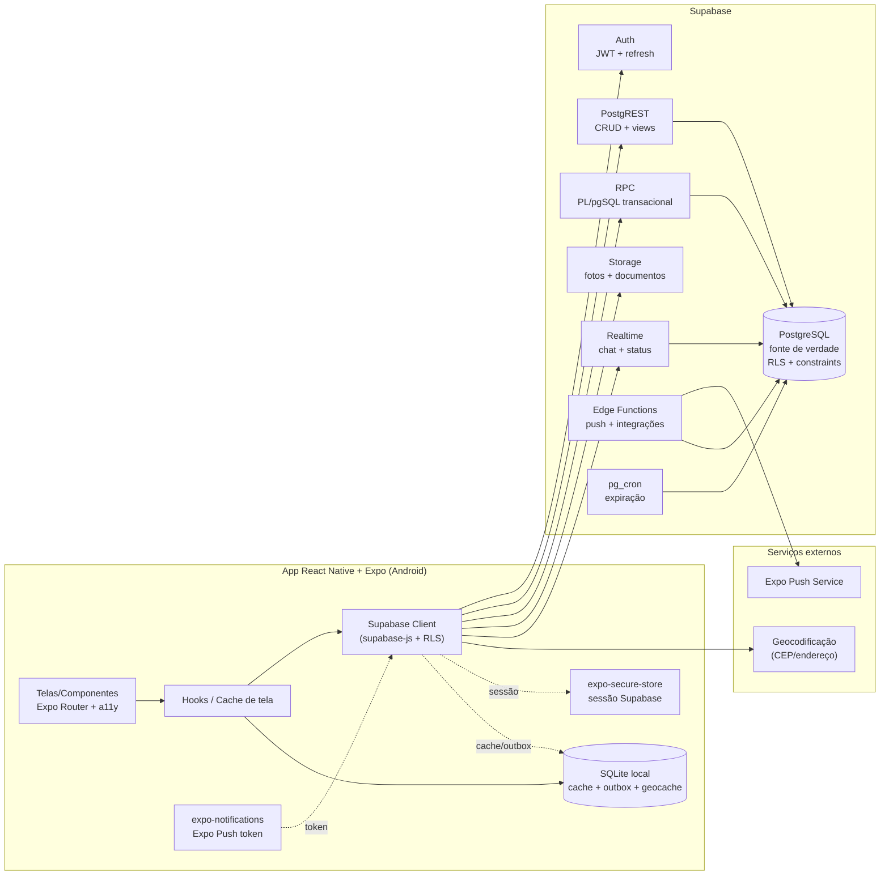

# 🗺️ Plano de Implementação (PLAN)

**Projeto:** App de Agendamento de Serviços de Beleza a Domicílio
**Versão:** 4.0 · **Última atualização:** 2026-11-08
**Fonte do escopo:** `docs/SPEC.md` (v1.4) · **Restrições:** `docs/CONSTITUTION.MD` (v1.3) · **Execução:** `docs/TASK.md`

> Este documento responde **como** entregar a SPEC. Mudanças aqui são baratas; mudanças na SPEC exigem o fluxo da Constituição (seção 1).
> **Decisão estruturante da v4.0:** arquitetura **Supabase-first** — o **Supabase** fornece PostgreSQL (fonte de verdade), Auth, Storage, Realtime, RPC e Edge Functions; o app **React Native + Expo** usa **SQLite (`expo-sqlite`) + Drizzle** apenas como cache/outbox. Ver SPEC §2.4 e Constituição C13–C19.

---

## 1. Premissas a Validar (decisões tomadas como provisórias)

| # | Premissa | Decisão provisória | Validar em |
|---|----------|--------------------|------------|
| A1 | Plataforma mobile | **React Native + Expo (TypeScript)**, alvo Android (RNF04) | Marco M0 |
| A2 | Banco remoto | **Supabase PostgreSQL** (projeto cloud + stack local via CLI) | Marco M0 |
| A3 | API | **API do Supabase**: PostgREST (CRUD), RPC (PL/pgSQL), Storage, Realtime e Edge Functions; **sem API Express** | Marco M0 |
| A4 | Schema remoto | **SQL migrations via Supabase CLI** em `supabase/migrations`; tipos TypeScript gerados com `supabase gen types typescript`; sem ORM remoto | Marco M0 |
| A5 | Cache local | **`expo-sqlite` + `drizzle-orm/expo-sqlite`**; schema/migrações com `drizzle-kit` | Marco M0 |
| A6 | Validação/contratos | **Zod** compartilhado em `packages/shared`; tipos gerados do banco; contratos de RPC/Edge Functions | Marco M0 |
| A7 | Autenticação | **Supabase Auth**: e-mail/senha, JWT access + refresh, hash bcrypt gerenciado; sessão em `expo-secure-store` | Marco M1 |
| A8 | Geolocalização | `expo-location` + **PostGIS no Supabase** (`ST_Distance`/`ST_DWithin`); prévia no app com módulo compartilhado | Marco M3 |
| A9 | Notificações | **Expo Push** + **Edge Function** disparada por Database Webhook; fallback local | Marco M5 |
| A10 | Arquivos | **Supabase Storage**: bucket público `portfolio` (fotos) e bucket privado `documentos` (URL assinada) | Marco M2 |
| A11 | Navegação/estado | **Expo Router** + React Context/hooks + `supabase-js`; sem lib global pesada | Marco M0 |
| A12 | Testes | **Vitest** (shared/app), **Jest + jest-expo + RNTL**, **Maestro**, **k6** (PostgREST/RPC), **better-sqlite3**, **pgTAP** (RLS/RPC) e **Supabase local** | Marco M0 |
| A13 | Deploy | **Supabase** (DB/Auth/Storage/Functions) + **EAS** (Android); CI GitHub Actions | Marco M0 |

> Se A2–A4 mudarem, a SPEC funcional continua válida; muda a infraestrutura. **Entretanto, C13–C15 tornam Supabase + API Supabase + SQLite-cache restrições atuais.**

## 2. Arquitetura



**Regras de ouro (Constituição P4/P8–P13):**
- **Telas** só renderizam/capturam entrada. **Zero regra de negócio, zero SQL e zero acesso direto ao Postgres.**
- **RPC/PL/pgSQL** concentram precificação, transições de estado, validação de agenda, expiração e auditoria. **Edge Functions** cuidam de push e integrações externas.
- **RLS** é a autorização padrão: o app usa `anon`/publishable key + JWT; `service_role` só em Edge Functions/rotinas administrativas.
- **Cálculo de distância e seleção de faixa** existem em módulo puro compartilhado (`packages/shared/deslocamento`) para prévia, mas a **decisão final é da RPC** no Supabase.
- **Transações no Supabase** obrigatórias para: reservar agenda + criar agendamento; aceitar/recusar; expirar; cancelar; salvar faixas + auditoria; aprovar/reprovar profissional.
- **App nunca confirma escrita crítica localmente**. Estado otimista é transitório e revertido em erro.
- **Migrações** (`supabase migration` + `supabase db push`) são versionadas, revisadas e aplicadas antes do deploy.
- **RLS testada** por perfil (`anon`, `authenticated`, admin) em toda tabela exposta.

**Contratos base (DoD):**
- `packages/shared`: schemas Zod de payloads de RPC, tipos de domínio, cálculo de deslocamento, formatação de dinheiro/data.
- **RPC:** recebe payload validado, aplica regra, grava em transação e retorna erro tipado (mensagem em português, sem stack/SQL cru).
- **PostgREST:** leituras e CRUDs simples protegidos por RLS; nenhuma tabela crítica aceita `INSERT/UPDATE` direto do cliente.
- **App:** `SupabaseClient` centraliza sessão, refresh, timeout, retry idempotente e mapeamento de erros.
- **SyncService:** pull por `atualizado_em` + push da outbox com `chave_idempotencia`.

### 2.1 Contrato da API Supabase (resumo — detalhar por marco)

| Área | Tabelas/Views (PostgREST) | RPCs / Edge Functions |
|------|---------------------------|------------------------|
| Auth | `auth.users` (Supabase Auth) | Trigger `handle_new_user`; RPC `meu_perfil` |
| Perfil | `usuario`, `cliente`, `profissional`, `endereco` | `salvar_config_deslocamento`, `aprovar_profissional` |
| Catálogo | `servico`, `foto_portfolio` (Storage) | — |
| Agenda | `agenda`, view `horarios_disponiveis` | `salvar_agenda` (opcional) |
| Busca | view `profissionais_publicos` | `buscar_profissionais(lat, lng, tipo?)` |
| Agendamento | `agendamento` (somente leitura) | `solicitar_agendamento`, `decidir_agendamento`, `cancelar_agendamento`, `concluir_agendamento` |
| Expiração | `agendamento` | `expirar_agendamentos()` via `pg_cron` |
| Chat | `mensagem` + Realtime | — |
| Avaliação | `avaliacao` | — |
| Admin | `profissional` | `aprovar_profissional` |
| Sync | `*` com `atualizado_em` | pull via PostgREST; push da outbox via RPC/PostgREST |
| Push | `dispositivo` | Edge Function `push` (Database Webhook) |

Padrões: RPC retorna `{ data }` ou erro com `code`/`message`; paginação por cursor (`atualizado_em`/`id`); `chave_idempotencia` obrigatória em escritas críticas; `401` renova a sessão via `supabase.auth.refreshSession()` uma vez.

## 3. Estrutura do Repositório (monorepo)

```
beleza-delivery/
├── apps/
│   └── mobile/                    # Expo (React Native + TypeScript)
│       ├── app/                   # rotas Expo Router
│       │   ├── (auth)/            # login, cadastro, seleção de perfil
│       │   ├── (cliente)/         # busca, agendamento, histórico, chat
│       │   ├── (profissional)/    # agenda, serviços, faixas, solicitações
│       │   ├── (admin)/           # aprovação de profissionais
│       │   └── _layout.tsx
│       ├── src/
│       │   ├── components/        # componentes acessíveis
│       │   ├── features/          # UI por domínio
│       │   ├── supabase/          # client, auth, uploads, realtime, erros
│       │   ├── db/                # schema SQLite, migrations, sync, outbox
│       │   ├── hooks/
│       │   ├── services/          # orquestração local (não regra crítica)
│       │   ├── theme/             # contraste, tipografia ampliável
│       │   └── utils/
│       ├── assets/
│       └── app.json / package.json / tsconfig.json
├── packages/
│   └── shared/                    # Zod contracts, tipos gerados, deslocamento, dinheiro
├── supabase/
│   ├── migrations/                # SQL versionado (schema, RLS, RPC, triggers)
│   ├── functions/
│   │   └── push/                  # Edge Function (Expo Push)
│   ├── seed.sql                   # seed idempotente
│   ├── tests/                     # pgTAP (RLS/RPC/constraints)
│   └── config.toml
├── docs/                          # fonte da verdade (SDD)
├── package.json                   # workspaces npm/pnpm
├── tsconfig.base.json
└── .github/workflows/ci.yml
```

## 4. Modelo de Dados (Supabase PostgreSQL — fonte de verdade)

Convenções: UUID (`gen_random_uuid()`), dinheiro **`INTEGER` centavos**, datas **`timestamptz`**, booleanos nativos, `criado_em/atualizado_em` em todas as tabelas. Localização em **PostGIS** (`geography(Point,4326)`).

```sql
CREATE EXTENSION IF NOT EXISTS "pgcrypto";
CREATE EXTENSION IF NOT EXISTS "btree_gist";
CREATE EXTENSION IF NOT EXISTS "postgis";
CREATE EXTENSION IF NOT EXISTS "pg_cron";

-- Perfil público do usuário; id espelha auth.users.id
CREATE TABLE usuario (
  id            uuid PRIMARY KEY REFERENCES auth.users(id) ON DELETE CASCADE,
  tipo          text NOT NULL CHECK (tipo IN ('cliente','profissional','admin')),
  email         text NOT NULL UNIQUE,
  ativo         boolean NOT NULL DEFAULT true,
  criado_em     timestamptz NOT NULL DEFAULT now(),
  atualizado_em timestamptz NOT NULL DEFAULT now(),
  excluido_em   timestamptz
);

CREATE TABLE dispositivo (
  id              uuid PRIMARY KEY DEFAULT gen_random_uuid(),
  usuario_id      uuid NOT NULL REFERENCES usuario(id) ON DELETE CASCADE,
  expo_push_token text NOT NULL UNIQUE,
  plataforma      text NOT NULL DEFAULT 'android',
  ultimo_uso_em   timestamptz NOT NULL DEFAULT now(),
  revogado_em     timestamptz
);

CREATE TABLE cliente (
  id            uuid PRIMARY KEY DEFAULT gen_random_uuid(),
  usuario_id    uuid NOT NULL UNIQUE REFERENCES usuario(id) ON DELETE CASCADE,
  nome          text NOT NULL,
  telefone      text,
  criado_em     timestamptz NOT NULL DEFAULT now(),
  atualizado_em timestamptz NOT NULL DEFAULT now()
);

CREATE TABLE endereco (
  id            uuid PRIMARY KEY DEFAULT gen_random_uuid(),
  cliente_id    uuid NOT NULL UNIQUE REFERENCES cliente(id) ON DELETE CASCADE,
  cep           text NOT NULL,
  rua           text NOT NULL,
  numero        text NOT NULL,
  complemento   text,
  bairro        text NOT NULL,
  cidade        text NOT NULL,
  localizacao   geography(Point,4326) NOT NULL,
  atualizado_em timestamptz NOT NULL DEFAULT now()
);

CREATE TABLE profissional (
  id                  uuid PRIMARY KEY DEFAULT gen_random_uuid(),
  usuario_id          uuid NOT NULL UNIQUE REFERENCES usuario(id) ON DELETE CASCADE,
  nome                text NOT NULL,
  cpf                 text NOT NULL UNIQUE,
  telefone            text,
  foto_url            text,
  documento_chave     text,
  status_verificacao  text NOT NULL DEFAULT 'pendente'
                      CHECK (status_verificacao IN ('pendente','aprovado','reprovado')),
  localizacao_ref     geography(Point,4326) NOT NULL,
  endereco_ref_bairro text NOT NULL,
  distancia_maxima_km numeric(6,2) NOT NULL CHECK (distancia_maxima_km > 0),
  prazo_resposta_h    integer NOT NULL DEFAULT 24 CHECK (prazo_resposta_h BETWEEN 1 AND 72),
  descricao           text,
  ativo               boolean NOT NULL DEFAULT true,
  criado_em           timestamptz NOT NULL DEFAULT now(),
  atualizado_em       timestamptz NOT NULL DEFAULT now()
);

CREATE TABLE faixa_deslocamento (
  id               uuid PRIMARY KEY DEFAULT gen_random_uuid(),
  profissional_id  uuid NOT NULL REFERENCES profissional(id) ON DELETE CASCADE,
  limite_km        numeric(6,2) NOT NULL CHECK (limite_km > 0),
  valor_centavos   integer NOT NULL CHECK (valor_centavos >= 0),
  ordem            integer NOT NULL CHECK (ordem >= 1),
  atualizado_em    timestamptz NOT NULL DEFAULT now(),
  UNIQUE (profissional_id, limite_km),
  UNIQUE (profissional_id, ordem)
);

CREATE TABLE servico (
  id               uuid PRIMARY KEY DEFAULT gen_random_uuid(),
  profissional_id  uuid NOT NULL REFERENCES profissional(id) ON DELETE CASCADE,
  tipo             text NOT NULL,
  preco_centavos   integer NOT NULL CHECK (preco_centavos >= 0),
  duracao_min      integer NOT NULL CHECK (duracao_min > 0),
  atualizado_em    timestamptz NOT NULL DEFAULT now()
);

CREATE TABLE agenda (
  id               uuid PRIMARY KEY DEFAULT gen_random_uuid(),
  profissional_id  uuid NOT NULL REFERENCES profissional(id) ON DELETE CASCADE,
  inicio           timestamptz NOT NULL,
  fim              timestamptz NOT NULL,
  status           text NOT NULL CHECK (status IN ('disponivel','ocupado','reservado')),
  atualizado_em    timestamptz NOT NULL DEFAULT now(),
  CHECK (fim > inicio),
  UNIQUE (profissional_id, inicio)
);

CREATE TABLE agendamento (
  id                          uuid PRIMARY KEY DEFAULT gen_random_uuid(),
  cliente_id                  uuid NOT NULL REFERENCES cliente(id),
  profissional_id             uuid NOT NULL REFERENCES profissional(id),
  servico_id                  uuid NOT NULL REFERENCES servico(id),
  endereco_id                 uuid NOT NULL REFERENCES endereco(id),
  inicio                      timestamptz NOT NULL,
  fim                         timestamptz NOT NULL,
  status                      text NOT NULL CHECK (status IN
                              ('pendente','confirmado','recusado','cancelado','concluido','expirado')),
  distancia_km                numeric(6,2),
  valor_deslocamento_centavos integer,
  total_centavos              integer,
  solicitado_em               timestamptz NOT NULL DEFAULT now(),
  responder_ate               timestamptz NOT NULL,
  decidido_em                 timestamptz,
  chave_idempotencia          text NOT NULL UNIQUE,
  atualizado_em               timestamptz NOT NULL DEFAULT now(),
  CHECK (fim > inicio),
  CHECK (valor_deslocamento_centavos IS NULL OR valor_deslocamento_centavos >= 0),
  CHECK (total_centavos IS NULL OR total_centavos >= 0)
);

-- Impede dupla reserva para o mesmo profissional e para o mesmo cliente
ALTER TABLE agendamento ADD CONSTRAINT ag_prof_sem_sobreposicao
  EXCLUDE USING gist (
    profissional_id WITH =,
    tstzrange(inicio, fim) WITH &&
  ) WHERE (status IN ('pendente','confirmado'));

ALTER TABLE agendamento ADD CONSTRAINT ag_cliente_sem_sobreposicao
  EXCLUDE USING gist (
    cliente_id WITH =,
    tstzrange(inicio, fim) WITH &&
  ) WHERE (status IN ('pendente','confirmado'));

CREATE TABLE avaliacao (
  id              uuid PRIMARY KEY DEFAULT gen_random_uuid(),
  agendamento_id  uuid NOT NULL UNIQUE REFERENCES agendamento(id) ON DELETE CASCADE,
  nota            integer NOT NULL CHECK (nota BETWEEN 1 AND 5),
  comentario      text,
  criado_em       timestamptz NOT NULL DEFAULT now(),
  atualizado_em   timestamptz NOT NULL DEFAULT now()
);

CREATE TABLE mensagem (
  id              uuid PRIMARY KEY DEFAULT gen_random_uuid(),
  agendamento_id  uuid NOT NULL REFERENCES agendamento(id) ON DELETE CASCADE,
  remetente_id    uuid NOT NULL REFERENCES usuario(id),
  conteudo        text NOT NULL CHECK (length(trim(conteudo)) > 0),
  enviada_em      timestamptz NOT NULL DEFAULT now(),
  atualizado_em   timestamptz NOT NULL DEFAULT now()
);

CREATE TABLE foto_portfolio (
  id              uuid PRIMARY KEY DEFAULT gen_random_uuid(),
  profissional_id uuid NOT NULL REFERENCES profissional(id) ON DELETE CASCADE,
  url             text NOT NULL,
  enviada_em      timestamptz NOT NULL DEFAULT now(),
  atualizado_em   timestamptz NOT NULL DEFAULT now()
);

CREATE TABLE log_auditoria (
  id              uuid PRIMARY KEY DEFAULT gen_random_uuid(),
  ator_usuario_id uuid REFERENCES usuario(id) ON DELETE SET NULL,
  acao            text NOT NULL,
  entidade        text NOT NULL,
  entidade_id     uuid,
  detalhe_json    jsonb,
  criado_em       timestamptz NOT NULL DEFAULT now()
);

CREATE INDEX idx_prof_busca   ON profissional(status_verificacao, ativo);
CREATE INDEX idx_prof_geo     ON profissional USING gist (localizacao_ref);
CREATE INDEX idx_end_geo      ON endereco USING gist (localizacao);
CREATE INDEX idx_faixa_prof   ON faixa_deslocamento(profissional_id, limite_km);
CREATE INDEX idx_servico_tipo ON servico(tipo);
CREATE INDEX idx_agenda_prof  ON agenda(profissional_id, inicio);
CREATE INDEX idx_ag_prof      ON agendamento(profissional_id, inicio);
CREATE INDEX idx_ag_cli       ON agendamento(cliente_id, inicio);
CREATE INDEX idx_ag_status    ON agendamento(status, responder_ate);
CREATE INDEX idx_ag_sync      ON agendamento(atualizado_em);
CREATE INDEX idx_msg_ag       ON mensagem(agendamento_id, enviada_em);
```

**Trigger de `atualizado_em`:**

```sql
CREATE OR REPLACE FUNCTION set_atualizado_em() RETURNS trigger
LANGUAGE plpgsql AS $$
BEGIN
  NEW.atualizado_em := now();
  RETURN NEW;
END $$;

-- Aplicar em todas as tabelas sincronizáveis (usuario, cliente, endereco,
-- profissional, faixa_deslocamento, servico, agenda, agendamento, avaliacao, mensagem, foto_portfolio).
```

**Trigger de perfil no signup (Supabase Auth):**

```sql
CREATE OR REPLACE FUNCTION handle_new_user() RETURNS trigger
LANGUAGE plpgsql SECURITY DEFINER SET search_path = public AS $$
BEGIN
  INSERT INTO usuario (id, tipo, email)
  VALUES (
    NEW.id,
    COALESCE(NEW.raw_user_meta_data->>'tipo', 'cliente'),
    NEW.email
  );
  IF COALESCE(NEW.raw_user_meta_data->>'tipo', 'cliente') = 'cliente' THEN
    INSERT INTO cliente (usuario_id, nome)
    VALUES (NEW.id, COALESCE(NEW.raw_user_meta_data->>'nome', NEW.email));
  END IF;
  RETURN NEW;
END $$;

CREATE TRIGGER on_auth_user_created
  AFTER INSERT ON auth.users
  FOR EACH ROW EXECUTE FUNCTION handle_new_user();
```

### 4.1 RLS (Row Level Security)

**Todas** as tabelas de `public` têm RLS habilitada. Funções auxiliares:

```sql
ALTER TABLE usuario ENABLE ROW LEVEL SECURITY;
ALTER TABLE dispositivo ENABLE ROW LEVEL SECURITY;
ALTER TABLE cliente ENABLE ROW LEVEL SECURITY;
ALTER TABLE endereco ENABLE ROW LEVEL SECURITY;
ALTER TABLE profissional ENABLE ROW LEVEL SECURITY;
ALTER TABLE faixa_deslocamento ENABLE ROW LEVEL SECURITY;
ALTER TABLE servico ENABLE ROW LEVEL SECURITY;
ALTER TABLE agenda ENABLE ROW LEVEL SECURITY;
ALTER TABLE agendamento ENABLE ROW LEVEL SECURITY;
ALTER TABLE avaliacao ENABLE ROW LEVEL SECURITY;
ALTER TABLE mensagem ENABLE ROW LEVEL SECURITY;
ALTER TABLE foto_portfolio ENABLE ROW LEVEL SECURITY;
ALTER TABLE log_auditoria ENABLE ROW LEVEL SECURITY;

CREATE OR REPLACE FUNCTION is_admin() RETURNS boolean
LANGUAGE sql STABLE SECURITY DEFINER SET search_path = public AS $$
  SELECT EXISTS (SELECT 1 FROM usuario WHERE id = auth.uid() AND tipo = 'admin');
$$;

CREATE OR REPLACE FUNCTION meu_cliente_id() RETURNS uuid
LANGUAGE sql STABLE SECURITY DEFINER SET search_path = public AS $$
  SELECT id FROM cliente WHERE usuario_id = auth.uid();
$$;

CREATE OR REPLACE FUNCTION meu_profissional_id() RETURNS uuid
LANGUAGE sql STABLE SECURITY DEFINER SET search_path = public AS $$
  SELECT id FROM profissional WHERE usuario_id = auth.uid();
$$;
```

**Matriz de políticas (resumo):**

| Tabela | `SELECT` | `INSERT/UPDATE/DELETE` |
|--------|----------|------------------------|
| `usuario` | próprio ou admin | próprio (campos de perfil); `tipo` só admin/RPC |
| `dispositivo` | próprio | próprio |
| `cliente` | próprio ou admin | próprio; criação via trigger |
| `endereco` | próprio; profissional só se agendamento `confirmado` | próprio cliente |
| `profissional` | aprovado+ativo (público) ou próprio/admin | próprio (perfil); status só via RPC admin |
| `faixa_deslocamento`, `servico`, `foto_portfolio` | público se profissional aprovado/ativo; próprio | próprio profissional |
| `agenda` | público (disponibilidade) / próprio | próprio profissional |
| `agendamento` | cliente dono, profissional dono ou admin | **sem escrita direta**; somente RPC |
| `mensagem` | participantes do agendamento | participantes; só após solicitação |
| `avaliacao` | público | cliente do agendamento concluído |
| `log_auditoria` | admin | somente triggers/RPC (`SECURITY DEFINER`) |

**Exemplo de política crítica — endereço liberado só após aceite:**

```sql
CREATE POLICY endereco_select ON endereco FOR SELECT USING (
  cliente_id = meu_cliente_id()
  OR is_admin()
  OR EXISTS (
    SELECT 1
    FROM agendamento a
    JOIN profissional p ON p.id = a.profissional_id
    WHERE a.endereco_id = endereco.id
      AND p.id = meu_profissional_id()
      AND a.status = 'confirmado'
  )
);
```

**Agendamento sem escrita direta:**

```sql
REVOKE INSERT, UPDATE, DELETE ON agendamento FROM anon, authenticated;
GRANT SELECT ON agendamento TO authenticated;
```

### 4.2 RPCs transacionais

**`solicitar_agendamento` (idempotente, congela valores):**

```sql
CREATE OR REPLACE FUNCTION solicitar_agendamento(
  p_profissional_id uuid,
  p_servico_id uuid,
  p_endereco_id uuid,
  p_inicio timestamptz,
  p_chave_idempotencia text
) RETURNS agendamento
LANGUAGE plpgsql SECURITY DEFINER SET search_path = public AS $$
DECLARE
  v_cliente   cliente;
  v_prof      profissional;
  v_servico   servico;
  v_end       endereco;
  v_agenda    agenda;
  v_existente agendamento;
  v_dist      numeric(6,2);
  v_faixa     faixa_deslocamento;
  v_ag        agendamento;
BEGIN
  SELECT * INTO v_existente FROM agendamento
   WHERE chave_idempotencia = p_chave_idempotencia;
  IF FOUND THEN
    RETURN v_existente;
  END IF;

  SELECT * INTO v_cliente FROM cliente WHERE usuario_id = auth.uid();
  IF NOT FOUND THEN
    RAISE EXCEPTION 'Cliente não encontrado' USING ERRCODE = 'P0001';
  END IF;

  SELECT * INTO v_prof FROM profissional
   WHERE id = p_profissional_id AND status_verificacao = 'aprovado' AND ativo;
  IF NOT FOUND THEN
    RAISE EXCEPTION 'Profissional indisponível' USING ERRCODE = 'P0002';
  END IF;

  SELECT * INTO v_servico FROM servico
   WHERE id = p_servico_id AND profissional_id = v_prof.id;
  IF NOT FOUND THEN
    RAISE EXCEPTION 'Serviço inválido' USING ERRCODE = 'P0003';
  END IF;

  SELECT * INTO v_end FROM endereco
   WHERE id = p_endereco_id AND cliente_id = v_cliente.id;
  IF NOT FOUND THEN
    RAISE EXCEPTION 'Endereço inválido' USING ERRCODE = 'P0004';
  END IF;

  SELECT * INTO v_agenda FROM agenda
   WHERE profissional_id = v_prof.id AND inicio = p_inicio
   FOR UPDATE;
  IF NOT FOUND OR v_agenda.status <> 'disponivel' THEN
    RAISE EXCEPTION 'Horário indisponível' USING ERRCODE = 'P0005';
  END IF;

  v_dist := ROUND((ST_Distance(v_prof.localizacao_ref, v_end.localizacao) / 1000)::numeric, 2);
  IF v_dist > v_prof.distancia_maxima_km THEN
    RAISE EXCEPTION 'Profissional não atende tão longe' USING ERRCODE = 'P0006';
  END IF;

  SELECT * INTO v_faixa FROM faixa_deslocamento
   WHERE profissional_id = v_prof.id AND limite_km >= v_dist
   ORDER BY limite_km ASC LIMIT 1;
  IF NOT FOUND THEN
    RAISE EXCEPTION 'Faixa de deslocamento indisponível' USING ERRCODE = 'P0007';
  END IF;

  INSERT INTO agendamento (
    cliente_id, profissional_id, servico_id, endereco_id,
    inicio, fim, status, distancia_km, valor_deslocamento_centavos,
    total_centavos, responder_ate, chave_idempotencia
  ) VALUES (
    v_cliente.id, v_prof.id, v_servico.id, v_end.id,
    p_inicio, p_inicio + make_interval(mins => v_servico.duracao_min),
    'pendente', v_dist, v_faixa.valor_centavos,
    v_servico.preco_centavos + v_faixa.valor_centavos,
    now() + make_interval(hours => v_prof.prazo_resposta_h),
    p_chave_idempotencia
  ) RETURNING * INTO v_ag;

  UPDATE agenda SET status = 'reservado'
   WHERE id = v_agenda.id;

  INSERT INTO log_auditoria (ator_usuario_id, acao, entidade, entidade_id, detalhe_json)
  VALUES (auth.uid(), 'agendamento_solicitado', 'agendamento', v_ag.id,
          jsonb_build_object('distancia_km', v_dist,
                             'valor_deslocamento_centavos', v_faixa.valor_centavos,
                             'total_centavos', v_ag.total_centavos));

  RETURN v_ag;
END $$;

REVOKE ALL ON FUNCTION solicitar_agendamento(uuid, uuid, uuid, timestamptz, text) FROM public;
GRANT EXECUTE ON FUNCTION solicitar_agendamento(uuid, uuid, uuid, timestamptz, text) TO authenticated;
```

**Demais RPCs (mesmo padrão):**

| RPC | Responsabilidade |
|-----|------------------|
| `salvar_config_deslocamento(p_distancia_maxima, p_faixas jsonb)` | Substitui faixas em transação, valida RN11/RN12 (crescentes, sem sobreposição, última = máxima), grava auditoria. |
| `decidir_agendamento(p_id, p_aceitar boolean)` | `FOR UPDATE`; valida dono e status `pendente`; aceite → `confirmado` + agenda `ocupado`; recusa → `recusado` + agenda `disponivel`; log. |
| `cancelar_agendamento(p_id)` | Valida prazo (RN03), dono (cliente/profissional), status; libera agenda; log. |
| `concluir_agendamento(p_id)` | `confirmado → concluido`; log; libera avaliação. |
| `aprovar_profissional(p_id, p_status)` | Só admin; `pendente → aprovado/reprovado`; log. |
| `expirar_agendamentos()` | `UPDATE ... WHERE status='pendente' AND responder_ate < now()`; libera agenda; log; retorna quantidade. |
| `buscar_profissionais(p_lat, p_lng, p_tipo?)` | `ST_DWithin` + `ST_Distance`, filtra aprovados/ativos e distância máxima; ordena por proximidade. |

**Expiração agendada:**

```sql
SELECT cron.schedule(
  'expirar-agendamentos',
  '*/5 * * * *',
  $$SELECT expirar_agendamentos();$$
);
```

### 4.3 Storage (bucket e políticas)

| Bucket | Acesso | Uso |
|--------|--------|-----|
| `portfolio` | público para leitura; escrita autenticada no próprio prefixo | fotos de perfil e trabalhos |
| `documentos` | privado; leitura por dono/admin | documentos de verificação (URL assinada de curta duração) |

```sql
-- Exemplo: leitura pública do portfólio
CREATE POLICY portfolio_read ON storage.objects FOR SELECT
USING (bucket_id = 'portfolio');

-- Exemplo: dono grava no próprio prefixo (path: <usuario_id>/...)
CREATE POLICY portfolio_write ON storage.objects FOR INSERT TO authenticated
WITH CHECK (
  bucket_id = 'portfolio'
  AND (storage.foldername(name))[1] = auth.uid()::text
);
```

### 4.4 Schema local (SQLite/Drizzle — cache + outbox)

O SQLite **não** replica o schema inteiro: mantém tabelas de leitura (`usuario_cache`, `profissional_cache`, `servico_cache`, `agenda_cache`, `agendamento_cache`, `mensagem_cache`, `avaliacao_cache`, `faixa_cache`) com os mesmos UUIDs e um subconjunto de campos, mais:

```sql
CREATE TABLE sync_state (
  entidade             TEXT PRIMARY KEY,
  ultimo_atualizado_em TEXT NOT NULL,
  ultimo_sync_em       TEXT NOT NULL
);

CREATE TABLE outbox (
  id                 TEXT PRIMARY KEY,          -- UUID
  entidade           TEXT NOT NULL,
  operacao           TEXT NOT NULL CHECK (operacao IN ('insert','update','delete')),
  payload_json       TEXT NOT NULL,
  chave_idempotencia TEXT NOT NULL UNIQUE,
  tentativas         INTEGER NOT NULL DEFAULT 0,
  proxima_tentativa_em TEXT,
  status             TEXT NOT NULL DEFAULT 'pendente'
                     CHECK (status IN ('pendente','enviando','falhou','concluido')),
  criado_em          TEXT NOT NULL
);

CREATE TABLE geocode_cache (
  consulta_hash      TEXT PRIMARY KEY,
  endereco_normalizado TEXT NOT NULL,
  latitude           REAL NOT NULL,
  longitude          REAL NOT NULL,
  expira_em          TEXT NOT NULL
);
```

Regras locais: `foreign_keys = ON`, `journal_mode = WAL`, dinheiro em centavos, datas ISO-8601 UTC, endereço completo só quando autorizado (RN22) e limpo no logout.

## 5. Migrações, Backup e Persistência

- **Supabase (schema):** `supabase migration new <nome>`; revisar SQL de schema + RLS + RPC no PR; aplicar com `supabase db push` (local: `supabase start` já aplica). Nunca alterar schema manualmente no Dashboard em produção.
- **Tipos:** `supabase gen types typescript --local > packages/shared/src/database.types.ts` (ou `--project-id` para o remoto).
- **SQLite:** migrations geradas por `drizzle-kit` em `apps/mobile/src/db/migrations`, aplicadas no boot com controle de versão e transação; falha = rollback + tela de erro amigável.
- **Seed:** `supabase/seed.sql` idempotente (admin, profissionais aprovados com faixas, serviços e agenda demo) para desenvolvimento/demo.
- **Backup remoto (RNF06):** PITR/branches do Supabase; teste de restore trimestral documentado.
- **Backup local (contingência):** exportar `.db` consistente (`VACUUM INTO`) via `expo-sharing`; importar via `expo-document-picker` com validação de versão.
- **Imagens:** comprimir no cliente (`expo-image-manipulator`) e enviar ao bucket `portfolio`; URLs públicas com transformação; apagar órfãos ao excluir portfólio/conta.
- **Documentos sensíveis:** upload no bucket privado `documentos`; acesso por URL assinada de curta duração; nunca públicos e nunca cacheados no SQLite.
- **Push:** Edge Function `push` recebe Database Webhook de `agendamento`/`mensagem`, busca tokens em `dispositivo` e envia via Expo Push; falhas ficam em log.
- **Realtime:** habilitar publicação para `mensagem` e `agendamento`; o app assina canais filtrados por agendamento/usuário.
- **LGPD:** exclusão de `auth.users` cascateia para `usuario`; anonimização de logs; exportação de dados do usuário sob solicitação via RPC/Edge Function.

## 6. Marcos e Sequenciamento

| Marco | Nome | Entregáveis | RFs cobertos |
|-------|------|-------------|--------------|
| **M0** | Fundação | Monorepo, Expo + Router, projeto Supabase + CLI + stack local, migrations com RLS/RPC iniciais, `packages/shared`, CI, deploy Supabase/EAS | — |
| **M1** | Conta, Perfil e Admin | Supabase Auth, trigger de perfil, perfis, endereço único, configuração de deslocamento, upload de documentos (Storage), aprovação admin | RF01–RF04, RF21, RF22, **RF26, RF27** |
| **M2** | Serviços, Agenda e Portfólio | CRUD de serviços/agenda via PostgREST + RLS, disponibilidade, portfólio no Storage | RF05, RF06, RF19 |
| **M3** | Busca e Disponibilidade | PostGIS (`buscar_profissionais`), filtro por distância máxima, ordenação, filtros, calendário | RF07–RF10, **RF30** |
| **M4** | Agendamento e Deslocamento | RPC `solicitar_agendamento`, valores congelados, aceite/recusa, expiração via `pg_cron`, constraints de sobreposição, logs | RF11–RF14, RF23–RF25, **RF28, RF29, RF31** |
| **M5** | Offline, Sync, Push e Chat | Cache SQLite, outbox idempotente, pull por cursor, Realtime, Expo Push via Edge Function, chat | **RF32**, RF14, RF15 |
| **M6** | Pós-Atendimento | Avaliação, histórico com valores, relatório do profissional | RF16–RF18, RF20 |
| **M7** | Endurecimento | Acessibilidade, RLS/pentest de políticas, LGPD, backup/restore, performance 1.000 simultâneos, k6 | RNF01–RNF15 |

**Ordem justificada:** M4 é o coração do escopo e depende de M3 (distância) e M1 (faixas). M5 pode iniciar em paralelo com M4 usando cache somente-leitura; a outbox entra após as RPCs críticas existirem. M7 audita o que foi construído, mas acessibilidade/segurança entram desde M1.

## 7. Estratégia de Testes

| Nível | Ferramenta | Alvo | Exemplos obrigatórios (SPEC) |
|-------|-----------|------|------------------------------|
| Unitário (shared/app) | **Vitest** | `deslocamento`, regras de validação | Tabela SPEC §6.3 (3,2; 7,4; 18; 25 km); fronteira 10,0 km; sem faixas; máx. < faixa |
| Contrato | Vitest + Zod | payloads de RPC/outbox | request/response válidos e inválidos; erros tipados |
| Banco/RLS | **pgTAP** + Supabase local | políticas, RPCs, constraints, triggers | anon não lê dados privados; cliente não vê agendamento alheio; endereço só pós-aceite; admin aprova |
| Integração RPC | Vitest + Supabase local | transações e concorrência | dupla reserva rejeitada; rollback; idempotência; expiração concorrente |
| Integração SQLite | Vitest + `better-sqlite3` | schema local/outbox | migrations; outbox idempotente; pull por cursor |
| UI | Jest + `jest-expo` + RNTL | telas/fluxos | solicitação → aceite → endereço liberado; offline bloqueia escrita crítica |
| E2E | Maestro (Android) | fluxos críticos | cadastro → busca → solicitar → aceitar/recusar; expiração; sync ao reconectar |
| Acessibilidade | TalkBack + Accessibility Scanner | todas as telas | foco, rótulos, contraste AA, alvos ≥ 48 dp |
| Performance | **k6** (PostgREST/RPC) + benchmark | 1.000 usuários simultâneos | busca < 3 s; p95 de RPCs críticas; taxa de erro < 1% |
| Backup/Restore | Script de integração | Supabase + SQLite | restore de branch/PITR; exportar → restaurar `.db` |
| Migração | Teste de upgrade | Supabase migrations e SQLite | v1 → vN preserva dados; falha faz rollback |

**Gates de release:** CI verde (`expo-doctor`, `tsc --noEmit`, ESLint, Vitest, Jest, pgTAP) + DoD da Constituição §4 + regressão de precificação + teste de concorrência/idempotência + restore validado.

## 8. Riscos e Mitigações

| Risco | Impacto | Mitigação |
|-------|---------|-----------|
| **RLS mal configurada** (vazamento entre usuários) | Privacidade/LGPD | Revisão obrigatória de políticas no PR; testes pgTAP por perfil; helper functions `SECURITY DEFINER`; negar por padrão |
| **`service_role` exposta no app** | Comprometimento total | Só em Edge Functions/CI; nunca no bundle; revisão de secrets; `anon` apenas com RLS |
| **Pausa/cota do plano Supabase free** | Indisponibilidade | Plano adequado para demo/produção; monitorar uso; backup/PITR; alertas |
| Latência/limites do PostgREST/RPC | Busca lenta, custo | Índices (GiST/compostos), paginação, queries enxutas, pooler Supavisor, medir p95 |
| **Cold start de Edge Function** | Push atrasado | Manter função aquecida para demo; operações críticas não dependem dela (push é assíncrono) |
| API/Realtime indisponível | Escrita crítica bloqueada | Estado offline explícito; retry com backoff; mensagens claras; monitoramento/alertas |
| Conflito de sincronização | Dados divergentes | Servidor autoritativo (RN18/RN20); idempotência; pull por cursor; testes de conflito |
| Dupla reserva | Agenda inconsistente | Exclusion constraints (`btree_gist`) + RPC com `FOR UPDATE` + teste concorrente |
| Vazamento de endereço/documento | LGPD/privacidade | RLS + view/RPC de autorização; bucket privado + URL assinada; logs com redação; cache mínimo |
| Storage sem limite/órfãos | Custo | Limite de upload (10 MB), compressão, limpeza de órfãos, monitorar uso |
| Geocodificação indisponível | Solicitação não completa | Cache `geocode_cache`; falha bloqueia com mensagem clara (RN13) |
| Distância em linha reta subestima deslocamento | Cobrança injusta | Exibir "aproximada" (RN13); rota real como evolução (SPEC §11) |
| Faixas inconsistentes | Cobrança errada | Validação RN11/RN12 no app e na RPC + prévia (CU 2.5) + testes + validação transacional |
| Exclusão de conta vs. histórico | Perda/retenção indevida | Anonimização; logs com ator nulo; política LGPD documentada |

## 9. Entrega Contínua

- `main` protegida: PR + CI verde + DoD + task atualizada.
- **Pipeline:** lint/typecheck/testes → `supabase db push` (projeto de teste/produção) → `supabase functions deploy push` → build mobile (EAS).
- **Ambientes:** local (`supabase start`), preview (projeto/branch Supabase separado + EAS preview), produção (projeto Supabase + EAS production).
- Versões: `v0.x` internas por marco; **`v1.0`** = M1–M6 completos; **`v1.4`** = SPEC v1.4 (Supabase-first); **`v1.4-hardened`** = M7.
- Changelog alimentado pelo *Registro de Mudanças* da SPEC (seção 13).
- Build Android via `eas build` (perfil `preview` para testes internos, `production` para release).

## 10. Fora deste Plano

Tudo listado em `SPEC.md` §11 (denúncias, salões, iOS, auto-aceite, pagamento integrado, Google, SQLCipher, modo totalmente offline com escrita crítica, sincronização peer-to-peer). Alterações aqui **não** alteram a SPEC.
