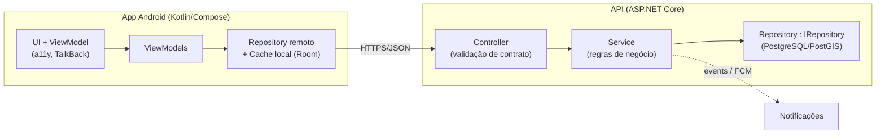

# 🗺️ Plano de Implementação (PLAN)

**Projeto:** App de Agendamento de Serviços de Beleza a Domicílio
**Versão:** 1.1 · **Última atualização:** 2026-10-29
**Fonte do escopo:** `docs/SPEC.md` (v1.1) · **Restrições:** `docs/CONSTITUTION.MD` · **Execução:** `docs/TASK.md`

> Este documento responde **como** entregar a SPEC. Mudanças aqui são baratas; mudanças na SPEC exigem o fluxo da Constituição (seção 1).

---

## 1. Premissas a Validar (decisões tomadas como provisórias)

| # | Premissa | Decisão provisória | Validar em |
|---|----------|--------------------|------------|
| A1 | Linguagem mobile | **Kotlin + Jetpack Compose** (Android nativo, RNF04/RNF08/TalkBack de primeira classe) | Marco M0 |
| A2 | Backend | **API REST** em **ASP.NET Core** (coerente com `IRepository` do `documentacao.pdf` seção 9) | Marco M0 |
| A3 | Banco | **PostgreSQL** (relacional, geoespacial com `PostGIS`) | Marco M0 |
| A4 | Geolocalização | Google Places/Geocoding API para endereço→coordenadas; distância por **haversine** na v1.1 (rota real = futuro) | Marco M3 |
| A5 | Autenticação | Firebase Auth (Google + e-mail/senha) | Marco M1 |
| A6 | Notificações | FCM | Marco M4 |
| A7 | Ambiente | Nenhum repositório/CI existente — criar do zero | M0 |

> Se A2 mudar (ex.: Node/Java), **apenas módulos de infra mudam** — a SPEC não afeta.

## 2. Arquitetura



**Regras de ouro (Constituição P4):**
- `Controller` só valida contrato e traduz HTTP ↔ DTO. **Zero regra de negócio.**
- `Service` concentra: precificação de deslocamento (SPEC §6), estados do agendamento (SPEC §7), validação de agenda.
- `Repository` atrás de `IRepository`; substituição de banco = nova implementação, sem tocar em Controller/Service.
- Cálculo de distância e seleção de faixa ficam em **`DeslocamentoService`** (módulo puro, sem I/O) — testável offline.

## 3. Estrutura do Repositório

```
aplicativo/
├── docs/                     # fonte da verdade (SDD)
│   ├── CONSTITUTION.MD
│   ├── SPEC.md
│   ├── PLAN.md
│   └── TASK.md
├── api/
│   ├── src/Aplicativo.Api/           # Controllers, DTOs, middleware
│   ├── src/Aplicativo.Core/          # Services, entities, regras (DeslocamentoService)
│   ├── src/Aplicativo.Infra/         # Repository : IRepository, EF Core, PostGIS
│   └── tests/Aplicativo.UnitTests/   # regras de negócio
├── app/
│   ├── src/main/.../ui/              # telas Compose + accessibility semantics
│   ├── src/main/.../data/            # Retrofit + Room (cache RNF07)
│   └── src/test + androidTest/       # unit + instrumentado/TalkBack
└── .github/workflows/ci.yml
```

## 4. Modelo de Dados (DDL resumido)

```sql
profissional(id PK, nome, cpf UNIQUE, telefone, foto_url, documento_url,
             status_verificacao, endereco_ref_lat, endereco_ref_lng,
             distancia_maxima_km NUMERIC NOT NULL,
             prazo_resposta_h INT NOT NULL DEFAULT 24,
             descricao, ativo BOOLEAN)

faixa_deslocamento(id PK, profissional_id FK,
                   limite_km NUMERIC NOT NULL CHECK (limite_km > 0),
                   valor NUMERIC NOT NULL CHECK (valor >= 0),
                   ordem INT,
                   UNIQUE(profissional_id, limite_km))

agenda(id PK, profissional_id FK, data, hora_inicio, hora_fim,
       status CHECK (status IN ('disponivel','ocupado','reservado')))

agendamento(id PK, cliente_id FK, profissional_id FK, servico_id FK,
            endereco_id FK, data_hora,
            status CHECK (status IN ('pendente','confirmado','recusado',
                                     'cancelado','concluido','expirado')),
            distancia_km NUMERIC,        -- RN14: congelado na solicitação
            valor_deslocamento NUMERIC,
            total NUMERIC,
            solicitado_em TIMESTAMPTZ, responder_ate TIMESTAMPTZ,
            decidido_em TIMESTAMPTZ)
-- índices: agendamento(profissional_id, data_hora), faixa(profissional_id, limite_km)
--          gin(geography) para busca por proximidade
```

**Invariantes obrigatórias (SPEC §5.2):** `distancia_maxima_km ≥ MAX(faixa.limite_km)`; limites de faixa estritamente crescentes; agendamento com status `pendente` ocupa a agenda como `reservado`.

## 5. Marcos e Sequenciamento

| Marco | Nome | Entregáveis | RFs cobertos |
|-------|------|-------------|--------------|
| **M0** | Fundação | Repo, CI (build+test+lint), soluções/projetos, `IRepository`, pipeline de BD, decisão sobre premissas A1–A7 | — |
| **M1** | Conta e Perfil | Cadastro Cliente/Profissional (com tela de **deslocamento**), login Google/e-mail, perfil, endereço único, aprovação do admin | RF01–RF04, RF21, RF22, **RF26, RF27** |
| **M2** | Serviços e Agenda | CRUD de serviços, agenda/dias/horários, portfólio | RF05, RF06, RF19 |
| **M3** | Busca e Disponibilidade | Geolocalização + cache offline, listagem por proximidade **com filtro de distância máxima**, filtros, calendário | RF07–RF10, **RF30** |
| **M4** | Agendamento e Deslocamento | Solicitação com **cálculo de deslocamento**, tela de decisão **aceitar/recusar**, expiração, notificações, bloqueio de agenda | RF11–RF14, RF23–RF25, **RF28, RF29, RF31** |
| **M5** | Comunicação e Pós | Chat, avaliação, histórico com valores, relatório | RF15–RF18, RF20 |
| **M6** | Endurecimento | Acessibilidade auditada, LGPD, logs de auditoria, backup, testes de carga (RNF12), performance de busca (RNF03) | RNF01–RNF12 |

**Ordem justificada:** M4 é o coração do novo escopo e depende de M3 (distância) e M1 (faixas). M6 pode absorver trabalho de qualquer marco anterior — não é "fase final opcional".

## 6. Estratégia de Testes

| Nível | Ferramenta | Alvo | Exemplos obrigatórios (SPEC) |
|-------|-----------|------|------------------------------|
| Unitário | xUnit / JUnit | `Service` + `DeslocamentoService` | Tabela SPEC §6.3 (3,2 km; 7,4 km; 18 km; 25 km); fronteira exata (10,0 km); sem faixas; máx. < faixa |
| Integração | Testcontainers + PostgreSQL | `Repository` + PostGIS | busca ordenada por proximidade; invariantes SQL |
| Contrato | Snapshot de OpenAPI | Controllers | payload sem endereço completo antes de `confirmado` |
| UI/Instrumentado | Espresso + Compose Test | fluxos críticos | solicitação → aceite → endereço liberado |
| Acessibilidade | TalkBack manual + Accessibility Scanner | todas as telas | foco, rótulos, contraste AA |
| Carga | k6 | busca de profissionais | 1.000 usuários simultâneos (RNF12) |

**Gates de release:** CI verde + DoD da Constituição §4 por task + regressão de precificação sempre que tocar em valores.

## 7. Riscos e Mitigações

| Risco | Impacto | Mitigação |
|-------|---------|-----------|
| Distância em linha reta subestima deslocamento real | Cobrança injusta / recusa | Exibir sempre "aproximada" (RN13); migrar para rota real (SPEC §11); cliente vê valor antes de confirmar (RF28) |
| Geocodificação indisponível | Solicitação não completa | Falha bloqueia o fluxo com mensagem clara (RN13); cache de CEPs |
| Profissional configura faixas inconsistentes | Cobrança errada | Validações RN11/RN12 + prévia de cálculo (CU 2.5 passo 5) |
| Solicitações expiradas geram conflito de agenda | Horário bloqueado à toa | Job de expiração transacional libera `reservado` (RF31) |
| Fuga de endereço (LGPD/privacidade) | Violação de RN09/C10 | Teste de contrato negativo: endereço completo só após `confirmado` |
| Escopo crescer (iOS, pagamentos) | Atraso | Seção 11 da SPEC = lista de bloqueio; qualquer adição passa por RFC |

## 8. Entrega Contínua

- `main` protegida: PR + CI verde + DoD + task atualizada.
- Versões: `v0.x` internas por marco; **`v1.0`** = M1–M5 completos; **`v1.1`** = SPEC v1.1 (deslocamento + decisão) entregue; **`v1.1-hardened`** = M6.
- Changelog do app alimentado pelo *Registro de Mudanças* da SPEC (seção 13).

## 9. Fora deste Plano

Tudo listado em `SPEC.md` §11 (denúncias, salões, iOS, auto-aceite, pagamento integrado). Alterações aqui **não** alteram a SPEC.
