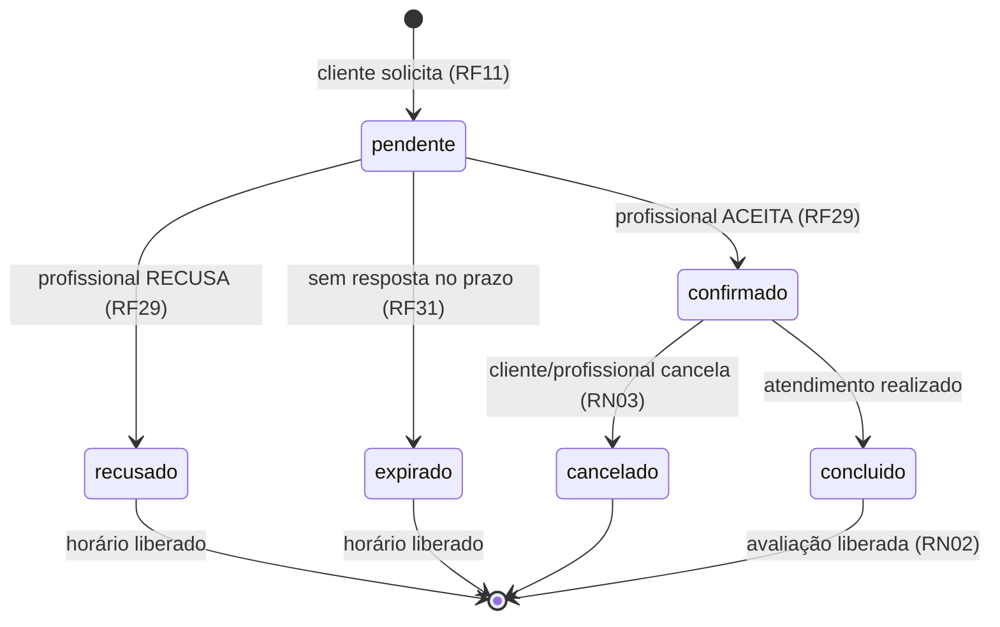

# 📋 Especificação de Requisitos (SPEC)

**Projeto:** App de Agendamento de Serviços de Beleza a Domicílio para Pessoas com Dificuldade de Mobilidade
**Versão:** 1.1 · **Status:** Ativa · **Última atualização:** 2026-10-29
**Documento base:** `documentacao.pdf` (v1.0) · **Governança:** `docs/CONSTITUTION.MD`

> **Como ler este documento.** Seção 1–2: contexto. Seção 3–5: *o quê* (RF, RNF, RN). Seção 6–7: regras críticas de precificação e estados. Seção 8: *quem faz* (casos de uso). Seção 9: *como é representado* (domínio). Seção 10: rastreabilidade. Seção 12: como comprovar entrega.
> Alterações só entram pela seção 13 (*Registro de Mudanças*).

---

## 1. Visão Geral

### 1.1 Objetivo
Permitir que o usuário localize profissionais de beleza próximos à sua residência e agende serviços **a domicílio**, com foco em pessoas com dificuldade de mobilidade, oferecendo um canal centralizado, acessível e seguro de busca, agendamento e comunicação.

### 1.2 Problema Identificado
- Idosos, pessoas com deficiência física e pós-cirúrgicos têm dificuldade de se deslocar até salões, barbearias e espaços de estética.
- Não há canal centralizado para localizar profissionais autônomos que atendam a domicílio.
- O agendamento é informal (telefone/WhatsApp), sem filtro por distância, disponibilidade ou tipo de serviço, e sem histórico/comunicação unificados.

### 1.3 Diretrizes centrais da v1.1
1. **Deslocamento tem preço definido pelo profissional** por faixas de distância (RF26).
2. **O profissional limita a distância que atende** (RF27) e nunca recebe solicitações além dela (RF30).
3. **O profissional aceita ou recusa cada solicitação** (RF12 + RF29), sob prazo de resposta (RF31).

## 2. Escopo e Atores

### 2.1 Atores
| Ator | Descrição |
|------|-----------|
| **Cliente** | Busca e agenda serviços de beleza. |
| **Profissional (autônomo)** | Presta serviços de beleza a domicílio; configura raio, faixas de deslocamento e agenda. |
| **Administrador** | Aprova ou reprova o cadastro de profissionais. |
| **Sistema** | Ator secundário: calcula distância/valor, expira solicitações, notifica, bloqueia agenda. |

### 2.2 Dentro do escopo
Cadastro (cliente/profissional/admin), perfil e endereço único, serviços, agenda do profissional, **configuração de deslocamento (faixas + distância máxima)**, busca por proximidade e filtros, calendário/disponibilidade, **solicitação com cálculo de deslocamento**, **aceite/recusa pelo profissional**, notificações, chat pós-solicitação, avaliação, histórico, relatório do profissional, portfólio, aprovação administrativa.

### 2.3 Fora de escopo → ver seção 11.

---

## 3. Requisitos Funcionais (RF)

### 3.1 Conta e Perfil
- **RF01** — Selecionar tipo de conta no cadastro (Cliente ou Profissional), direcionando para o formulário correspondente.
- **RF02** — Cadastrar cliente (nome, email, telefone e senha, ou cadastro/login via Google — sem foto).
- **RF03** — Cadastrar profissional (dados pessoais, foto de perfil, documentos para verificação, serviços oferecidos, **configuração de atendimento a domicílio: distância máxima e faixas de deslocamento** — ver RF26/RF27).
- **RF04** — Editar perfil (cliente e profissional).
- **RF05** — Cadastrar/editar serviços oferecidos (tipo, preço, duração).
- **RF22** — Cliente cadastra **um único** endereço estruturado (rua, número, bairro, complemento, CEP), usado em todos os agendamentos.
- **RF23** — Cliente **confirma o uso** do endereço cadastrado ao solicitar agendamento, podendo editá-lo antes de confirmar.

### 3.2 Serviços e Disponibilidade (Profissional)
- **RF06** — Profissional cadastra dias e horários de disponibilidade (agenda).
- **RF19** — Profissional cadastra fotos de trabalhos realizados (portfólio).
- **RF18** — Emitir relatório de atendimentos realizados (profissional).

### 3.3 Busca e Agendamento (Cliente)
- **RF07** — Cliente visualiza calendário do profissional com dias disponíveis em destaque.
- **RF08** — Cliente seleciona um dia e visualiza os horários disponíveis naquele dia.
- **RF09** — Listar profissionais por proximidade (geolocalização), **mais próximos primeiro** e **somente os que atendem na distância do cliente (RF27/RF30)**.
- **RF10** — Filtrar a listagem de profissionais por tipo de serviço.
- **RF11** — Solicitar agendamento de horário.
- **RF13** — Cancelar agendamento (cliente ou profissional).
- **RF14** — Notificar cliente e profissional sobre confirmação/cancelamento.
- **RF20** — Cliente visualiza o portfólio do profissional ao acessar seu perfil.
- **RF24** — Profissional visualiza **apenas a distância aproximada** até o cliente antes de confirmar o agendamento.
- **RF25** — Profissional visualiza o **endereço completo** do atendimento **após** confirmar o agendamento.

### 3.4 Novos requisitos — Deslocamento e Aceite (v1.1)
- **RF26 — Faixas de cobrança de deslocamento.** O profissional cadastra, na **configuração inicial** (e pode editar depois), uma ou mais faixas de deslocamento, cada uma com **limite de distância em km** e **valor em R$** — ex.: *até 5 km = R$ 5,00; até 10 km = R$ 8,00; até 20 km = R$ 12,00*. Os pontos (faixas) são **100% definidos pelo profissional**.
- **RF27 — Distância máxima de atendimento.** O profissional define a **distância máxima (km)** que está disposto a atender. Ela delimita: (a) onde ele aparece na busca; (b) quais solicitações recebe; (c) o teto válido das faixas de deslocamento.
- **RF28 — Cálculo e exibição do valor de deslocamento.** Ao escolher horário/endereço, o sistema calcula a distância aproximada entre o **endereço de referência do profissional** e o **endereço do cliente**, seleciona a faixa correspondente e exibe ao cliente: *valor do serviço + valor de deslocamento + total*, antes da confirmação (seção 6).
- **RF29 — Decisão do profissional sobre a solicitação.** Na tela de solicitação pendente, o profissional vê **distância aproximada, valor de deslocamento e total**, e pode **Aceitar** ou **Recusar** (complementa RF12 e RF24). Recusa devolve o horário a *disponível*; aceite bloqueia a agenda (RN07) e libera o endereço completo (RF25).
- **RF30 — Bloqueio por distância máxima.** Solicitações com distância **maior que a distância máxima** do profissional **não são geradas**: o profissional não aparece na listagem do cliente e a tentativa de agendar exibe aviso claro de indisponibilidade.
- **RF31 — Prazo de resposta.** Solicitação sem aceite/recusa dentro do prazo configurado (padrão **24 h**) **expira automaticamente**: horário liberado, status `expirado`, cliente notificado.

---

## 4. Requisitos Não Funcionais (RNF)

| ID | Requisito |
|----|-----------|
| RNF01 | Autenticação segura. |
| RNF02 | Interface acessível: fontes ampliáveis, alto contraste, compatível com leitor de tela. |
| RNF03 | Tempo de resposta da busca por profissionais **< 3 s**. |
| RNF04 | Aplicativo funcional em **Android**. |
| RNF05 | Dados pessoais tratados conforme a **LGPD**. |
| RNF06 | **Backup periódico** dos dados. |
| RNF07 | Busca geográfica funcional com **conexão instável** (cache local). |
| RNF08 | Compatível com leitores de tela nativos (**TalkBack**) — público-alvo com baixa visão. |
| RNF09 | **Logs de auditoria** para ações sensíveis (confirmação/cancelamento de agendamento, aprovação de profissional, **aceite/recusa e mudanças de tarifa de deslocamento**). |
| RNF10 | **Feedback visual em ≤ 1 s** após qualquer ação do usuário. |
| RNF11 | Fotos de perfil e portfólio comprimidas/otimizadas no upload. |
| RNF12 | Suporte a **≥ 1.000 usuários simultâneos** sem degradação perceptível. |

---

## 5. Regras de Negócio (RN)

### 5.1 Originais (v1.0)
- **RN01** — Um profissional só pode confirmar agendamento em horário livre na própria agenda.
- **RN02** — O cliente só pode avaliar o profissional após o atendimento ser concluído.
- **RN03** — Cancelamento respeita prazo mínimo (ex.: 2 h antes do horário marcado).
- **RN04** — O CPF do profissional é único no sistema.
- **RN05** — Um profissional só oferece atendimento a domicílio se informar o raio/distância de atuação (**atendida por RN10 e RN11**).
- **RN06** — Um cliente não pode ter dois agendamentos sobrepostos no mesmo horário.
- **RN07** — O agendamento **confirmado** bloqueia automaticamente na agenda o intervalo equivalente à duração do serviço.
- **RN08** — O chat só fica disponível após uma solicitação de agendamento.
- **RN09** — O profissional só visualiza o endereço completo após confirmar; antes, apenas **distância aproximada ou bairro**.

### 5.2 Novas — Deslocamento, distância e decisão (v1.1)
- **RN10 (composição da tarifa)** — O valor de deslocamento é o valor da **menor faixa cujo limite (km) ≥ distância calculada**. Ex.: distância 7,4 km → faixa *até 10 km* → R$ 8,00.
- **RN11 (integridade das faixas)** — Cada faixa pertence a um profissional; deve ter `limiteKm > 0`, `valor ≥ 0`, limites **estrictamente crescentes e sem sobreposição**; um profissional com atendimento a domicílio ativo possui **≥ 1 faixa**; a **última faixa deve ser igual à distância máxima** (RN12). Faixas são editáveis a qualquer momento.
- **RN12 (distância máxima)** — A distância máxima informada pelo profissional é o **teto de atendimento**: limita a exibição na busca (RF09), o recebimento de solicitações (RF30) e deve ser **≥ último limite de faixa** (validação no formulário).
- **RN13 (origem da distância)** — Distância calculada entre o **endereço de referência do profissional** e o **endereço do cliente**, por geocodificação/rota; sempre exibida como **"aproximada"**. Se o cálculo falhar, a solicitação **não prossegue** (nunca se cobra a cegas).
- **RN14 (congelamento do valor)** — `distância`, `valorDeslocamento` e `total` são **gravados no agendamento no momento da solicitação** e não mudam com edições posteriores das faixas.
- **RN15 (decisão)** — Toda solicitação fica **pendente** até **Aceite**, **Recusa** ou **expiração (RF31)**. Horário fica `reservado` durante a pendência e volta a `disponível` em recusa/expiração.
- **RN16 (exibição ao profissional)** — Antes do aceite o profissional vê apenas **distância aproximada + bairro** e o **valor da tarifa/total**; **nunca** o endereço completo (RN09) e **nunca** dados pessoais além do primeiro nome.

---

## 6. Precificação de Deslocamento — Especificação Detalhada

### 6.1 Configuração inicial do profissional (RF26 + RF27)
Tela **"Meu Atendimento a Domicílio"**, preenchida no onboarding e editável depois:

| Campo | Obrigatório | Validação |
|-------|-------------|-----------|
| Distância máxima de atendimento (km) | Sim | `> 0`; `≥ maior limite de faixa` |
| Faixas de deslocamento (n ≥ 1) | Sim | `limiteKm > 0`, `valor ≥ 0`, limites crescentes, sem sobreposição |
| Aceitar agendamento apenas sob confirmação | Sim (fixo `Sim` na v1.1) | Reservado para auto-aceite futuro (seção 11) |
| Prazo de resposta (h) | Não | padrão `24`, entre `1` e `72` |

**Exemplo de saída esperada:**

| Faixa | Limite (km) | Valor (R$) |
|-------|-------------|------------|
| 1 | até 5 | 5,00 |
| 2 | até 10 | 8,00 |
| 3 | até 20 | 12,00 |

*Distância máxima de atendimento: 20 km (= última faixa).*

### 6.2 Algoritmo de cálculo (RF28 / RN10)
```
ENTRADA: distanciaKm, faixas[] (ordenadas por limiteKm crescente), distanciaMaximaKm

1. se distanciaKm > distanciaMaximaKm  -> INDISPONIVEL (RF30)
2. percorrer faixas na ordem:
      se distanciaKm <= faixa.limiteKm -> valorDeslocamento = faixa.valor; SAIR
3. (defensivo) nenhuma faixa casou -> INDISPONIVEL (RF30)
4. total = servico.preco + valorDeslocamento
5. persistir no agendamento: distanciaKm, valorDeslocamento, total (RN14)
```

### 6.3 Exemplos de aceite
| Distância | Faixa aplicada | Deslocamento | Serviço (ex.: R$ 45,00) | Total |
|-----------|----------------|--------------|--------------------------|-------|
| 3,2 km | até 5 km | R$ 5,00 | R$ 45,00 | **R$ 50,00** |
| 7,4 km | até 10 km | R$ 8,00 | R$ 45,00 | **R$ 53,00** |
| 18,0 km | até 20 km | R$ 12,00 | R$ 45,00 | **R$ 57,00** |
| 25,0 km (> 20 km máx.) | — | — | — | **Indisponível** |

### 6.4 Exibição
- **Cliente (antes de confirmar):** serviço + deslocamento (`R$ 8,00 · até 10 km`) + **total**, com a distância aproximada. Recalcula ao trocar de profissional/endereço.
- **Profissional (antes de decidir):** distância aproximada + bairro + tarifa que será cobrada + total (RN16).
- **Após confirmação:** os mesmos valores aparecem no histórico/relatório (RF17/RF18), imutáveis (RN14).

---

## 7. Estados do Agendamento



Efeitos: `confirmado` → bloqueia agenda (RN07), libera endereço completo (RF25), notifica (RF14). `recusado`/`expirado` → horário volta a `disponível` e cliente é notificado. `concluido` → libera avaliação (RN02) e chat histórico.

---

## 8. Casos de Uso

> Transcritos de `documentacao.pdf` seções 7.1–7.5, **com as alterações da v1.1 sinalizadas em ➕**. Diagrama visual: PDF seção 7.6.

### 8.1 Conta e Perfil
**CU 1.1 — Selecionar Tipo de Conta**
*Ator:* usuário não autenticado · *Pré:* acessa a tela de cadastro.
Fluxo: 1) seleciona "Cliente" ou "Profissional"; 2) Cliente → formulário simplificado (nome, email, telefone, senha ou Google); 3) Profissional → formulário completo (dados pessoais, foto, documentos, serviços, **distância máxima e faixas de deslocamento ➕**).

**CU 1.2 — Cadastro de Cliente**
*Ator:* Cliente · *Pré:* escolheu "Cliente".
Fluxo: 1) escolhe Google ou email/senha; 2) Google → autenticação do provedor; 3) email/senha → nome, email, telefone e senha; 4) validação → cria conta; 5) direciona à tela inicial.

**CU 1.3 — Cadastro de Profissional**
*Ator:* Profissional · *Pré:* escolheu "Profissional".
Fluxo: 1) dados pessoais (nome, CPF, telefone, endereço de referência); 2) foto de perfil; 3) documento de verificação; 4) serviços prestados **+ configuração de deslocamento (distância máxima e faixas) ➕**; 5) salva com status `pendente`; 6) administrador aprova/reprova; 7) após aprovação, notifica e libera o uso.

**CU 1.4 — Login** · *Ator:* Cliente/Profissional. 1) escolhe método; 2) valida credenciais; 3) direciona à tela inicial do perfil.

**CU 1.5 — Editar Perfil** · *Ator:* Cliente/Profissional. 1) acessa edição; 2) altera nome, foto, descrição, endereço de referência, **distância máxima e faixas de deslocamento ➕**; 3) salva (mudanças de tarifa geram log — RNF09 ➕).

**CU 1.6 — Cadastrar Endereço** · *Ator:* Cliente. 1) seção "Meu Endereço"; 2) CEP, rua, número, bairro, complemento; 3) salva como endereço único usado em todos os agendamentos; 4) editável a qualquer momento.

**CU 1.7 — Aprovar/Reprovar Cadastro de Profissional** · *Ator:* Administrador · *Pré:* cadastro `pendente`. 1) lista pendentes; 2) analisa dados e documento; 3) aprova ou reprova; 4) atualiza status e notifica.

### 8.2 Serviços e Disponibilidade (Profissional)
**CU 2.1 — Cadastrar/Editar Serviço** · 1) seção "Meus Serviços"; 2) adiciona/edita com tipo, preço e duração; 3) salva.
**CU 2.2 — Cadastrar Disponibilidade (Agenda)** · 1) seção "Minha Agenda"; 2) seleciona dias e horários; 3) salva.
**CU 2.3 — Cadastrar Fotos do Portfólio** · 1) seção "Portfólio"; 2) upload de fotos; 3) salva e exibe no perfil público.
**CU 2.4 — Visualizar Portfólio do Profissional** · *Ator:* Cliente. 1) acessa perfil; 2) galeria exibida.

**CU 2.5 — ➕ Configurar Atendimento a Domicílio (faixas e distância máxima)**
*Descrição:* O profissional define **quanto cobra pelo deslocamento** e **até onde atende**.
*Ator:* Profissional · *Pré:* autenticado, cadastro aprovado (ou no onboarding).
*Fluxo Principal:*
1) Acessa **"Meu Atendimento a Domicílio"** (onboarding ou perfil);
2) Informa a **distância máxima de atendimento (km)**;
3) Cadastra as **faixas de deslocamento** (limite em km + valor em R$), na ordem desejada — ex.: *5 km → R$ 5,00; 10 km → R$ 8,00; 20 km → R$ 12,00*;
4) O sistema valida (RN11, RN12): limites crescentes, sem sobreposição, última faixa = distância máxima;
5) Exibe **prévia de cálculo** (3 exemplos: menor, intermediária e maior faixa) para confirmação;
6) Salva e registra log de auditoria (RNF09).
*Fluxos alternativos:*
- **4a. Validação falha** → mensagem específica ("A última faixa (15 km) deve corresponder à distância máxima (20 km)") e permanece na tela.
- **5a. Sem faixas cadastradas** → o profissional **não pode** ser publicado na busca (RN05/RN11).
*Pós-condição:* faixas e distância máxima vigentes; listagem e cálculos passam a usá-las (RF09, RF28, RF30).

### 8.3 Busca e Agendamento (Cliente)
**CU 3.1 — Listar Profissionais por Proximidade** · 1) tela de busca; 2) identifica localização; 3) lista ordenada do mais próximo ao mais distante **e filtrada pela distância máxima de cada profissional ➕**.
**CU 3.2 — Filtrar por Tipo de Serviço** · 1) seleciona tipo (ex.: manicure); 2) lista atualizada com quem oferece o serviço.
**CU 3.3 — Visualizar Calendário de Disponibilidade** · 1) calendário com dias destacados; 2) seleciona dia; 3) horários livres (descontando ocupados).

**CU 3.4 — Solicitar Agendamento** ➕ *atualizado*
*Pré:* cliente selecionou profissional, serviço e horário disponível.
1) Escolhe serviço e horário;
2) Sistema preenche o endereço único, cliente revisa e confirma (RF23);
3) ➕ Sistema calcula **distância aproximada** (RN13) e valida contra a **distância máxima** do profissional (RF30) — se exceder, exibe *"Profissional não atende tão longe"* e interrompe;
4) ➕ Sistema calcula o **valor de deslocamento** pela faixa correspondente (RN10) e exibe **serviço + deslocamento + total** ao cliente (RF28);
5) Cliente confirma → solicitação enviada ao profissional, que vê apenas **distância aproximada/bairro + tarifa** (RN09, RN16);
6) Horário marcado como **`reservado`** até a decisão, com expiração em 24 h (RF31 ➕).

**CU 3.5 — Aceitar ou Recusar Solicitação (Profissional)** ➕ *reformula RF12*
*Pré:* existe solicitação `pendente`.
1) Profissional abre a solicitação e vê: **data/hora, serviço, distância aproximada, bairro, valor do deslocamento e total** (RF29, RN16 — sem endereço completo);
2) Escolhe **Aceitar** ou **Recusar**;
3a) **Aceite** → bloqueia o intervalo na agenda (RN07), libera o **endereço completo** (RF25), grava distância/valores (RN14);
3b) **Recusa** → horário volta a `disponível`, status `recusado`;
4) Sistema notifica o cliente sobre a decisão (RF14) e registra log (RNF09).

**CU 3.6 — Cancelar Agendamento** · 1) acessa "Próximos Agendamentos"; 2) seleciona cancelar; 3) valida prazo mínimo (RN03); 4) cancela e libera o horário; 5) notifica a outra parte.

**CU 3.7 — ➕ Expirar Solicitação Sem Resposta (Sistema)**
*Ator:* Sistema · *Pré:* solicitação `pendente` há mais de 24 h (ou prazo configurado).
1) Ao vencer o prazo, o sistema muda o status para `expirado`; 2) libera o horário na agenda; 3) notifica o cliente ("o profissional não respondeu a tempo"); 4) registra log (RNF09).

### 8.4 Comunicação
**CU 4.1 — Conversar via Chat** · *Pré:* existe solicitação de agendamento (RN08) — serve para combinar detalhes (ponto de referência), **nunca para transmitir o endereço**. 1) abre a conversa vinculada; 2) envia mensagens; 3) entrega à outra parte; 4) notifica quando em segundo plano.

### 8.5 Pós-Atendimento
**CU 5.1 — Avaliar Profissional** · *Pré:* atendimento concluído (RN02). 1) solicita nota e comentário opcional; 2) cliente informa; 3) salva no perfil.
**CU 5.2 — Visualizar Histórico** · 1) seção "Histórico"; 2) lista com status (concluído, cancelado, pendente) **e valores de serviço/deslocamento/total ➕**.
**CU 5.3 — Emitir Relatório de Atendimentos** · 1) seleciona período; 2) gera relatório com atendimentos, **valores (incluindo deslocamento) ➕** e avaliações.

---

## 9. Modelo de Domínio

### 9.1 Entidades (atributos **negrito** = novos na v1.1)

**Cliente:** `id`, `nome`, `email`, `senha` (ou vínculo Google), `telefone`, `endereço (1:1)`
**Endereço:** `id`, `cliente (1:1)`, `cep`, `rua`, `número`, `complemento`, `bairro`, `cidade`
**Profissional:** `id`, `nome`, `cpf`, `telefone`, `foto de perfil`, `documento de verificação`, `status de verificação (pendente|aprovado|reprovado)`, `endereço de referência`, `raio/distância de atendimento` *(substituído por:* **`distância máxima (km)`** *+* **`faixas []`***)*, `**prazo de resposta (h)**`, `descrição`
**FaixaDeslocamento** 🆕: `id`, `profissional (ref)`, `**limiteKm**`, `**valor (R$)**`, `ordem`
**Serviço:** `id`, `profissional (ref)`, `tipo`, `preço`, `duração`
**Agenda:** `id`, `profissional (ref)`, `data`, `hora de início`, `hora de fim`, `status (disponível|ocupado|reservado)`
**Agendamento:** `id`, `cliente (ref)`, `profissional (ref)`, `serviço (ref)`, `endereço (ref)`, `data e hora`, `status (pendente|confirmado|recusado|cancelado|concluído|`**`expirado`**`)`, **`distância (km)`**, **`valor de deslocamento`**, **`total`**, **`solicitado em`**, **`responder até`**, **`decidido em`**
**Avaliação:** `id`, `agendamento (ref)`, `nota`, `comentário`, `data`
**Mensagem:** `id`, `agendamento (ref)`, `remetente`, `conteúdo`, `enviada em`
**Foto do Portfólio:** `id`, `profissional (ref)`, `url da imagem`, `enviada em`

### 9.2 Relacionamentos
- Cliente → solicita → Agendamento · Cliente → possui (1:1) → Endereço
- Endereço → referenciado em → Agendamento
- Profissional → oferece → Serviço · Profissional → define → Agenda
- Profissional → **define (1:N) → FaixaDeslocamento** 🆕
- Profissional → possui → Foto do Portfólio · Profissional → atende → Agendamento
- Serviço → compõe → Agendamento · Agendamento → gera → Avaliação · Agendamento → contém → Mensagem

### 9.3 Diagrama ER

```mermaid
erDiagram
    CLIENTE ||--|| ENDERECO : "possui 1:1"
    CLIENTE ||--o{ AGENDAMENTO : solicita
    ENDERECO ||--o{ AGENDAMENTO : "referenciado em"
    PROFISSIONAL ||--o{ SERVICO : oferece
    PROFISSIONAL ||--o{ AGENDA : define
    PROFISSIONAL ||--o{ FAIXA_DESLOCAMENTO : "define 1:N"
    PROFISSIONAL ||--o{ FOTO_PORTFOLIO : possui
    PROFISSIONAL ||--o{ AGENDAMENTO : atende
    SERVICO ||--o{ AGENDAMENTO : "compõe"
    AGENDAMENTO ||--o| AVALIACAO : gera
    AGENDAMENTO ||--o{ MENSAGEM : contém
    FAIXA_DESLOCAMENTO {
      int id PK
      int profissional_id FK
      decimal limite_km
      decimal valor
      int ordem
    }
    PROFISSIONAL {
      int id PK
      string cpf UQ
      decimal distancia_maxima_km
      int prazo_resposta_h
    }
    AGENDAMENTO {
      int id PK
      string status
      decimal distancia_km
      decimal valor_deslocamento
      decimal total
      datetime responder_ate
    }
```

---

## 10. Matriz de Rastreabilidade (RF ↔ RN ↔ CU)

| RF | RN | CU | Teste mínimo |
|----|----|----|--------------|
| RF01–RF02 | — | 1.1, 1.2 | cadastro completo/incompleto |
| RF03 | RN04, RN05 | 1.3, **2.5** | CPF duplicado; sem faixa ⇒ não publicado |
| RF04 | — | 1.5 | editar dist. máxima e tarifas + log |
| RF05 | — | 2.1 | serviço com duração/preço inválidos |
| RF06 | RN01 | 2.2 | horário livre obrigatório |
| RF07–RF08 | RN07 | 3.3 | horário ocupado não aparece |
| RF09 | **RN12**, **RN10** | 3.1 | ordenação + filtro por distância máxima |
| RF10 | — | 3.2 | filtro por serviço |
| RF11 | RN14 | 3.4 | gravação imutável dos valores |
| RF12/RF29 | **RN15**, RN09, **RN16** | 3.5 | aceite bloqueia agenda; recusa libera |
| RF13 | RN03 | 3.6 | cancelamento fora do prazo negado |
| RF14 | — | 3.5, 3.6, **3.7** | notificação em cada transição |
| RF15 | RN08 | 4.1 | chat só após solicitação |
| RF16 | RN02 | 5.1 | avaliação antes do fim negada |
| RF17/RF20 | — | 5.2, 2.4 | histórico e portfólio |
| RF18 | — | 5.3 | relatório com valores |
| RF19 | — | 2.3 | upload + compressão (RNF11) |
| RF21 | — | 1.7 | aprovação/reprovação + notificação |
| RF22–RF23 | — | 1.6, 3.4 | endereço único revisado |
| RF24/RF25 | RN09 | 3.5 | endereço completo só pós-aceite |
| **RF26** | **RN11** | **2.5** | faixas inválidas rejeitadas |
| **RF27** | **RN12** | **2.5** | máx. < última faixa ⇒ erro |
| **RF28** | **RN10**, RN13 | 3.4 | tabela de exemplos (seção 6.3) |
| **RF30** | **RN12** | 3.1, 3.4 | 25 km ⇒ indisponível |
| **RF31** | **RN15** | 3.7 | expiração em 24 h libera horário |

---

## 11. Fora de Escopo (v1.1) e Trabalhos Futuros

**Não será construído agora:** sistema de denúncias/suporte; vínculo com salões/estabelecimentos; suporte a iOS; **aceite automático de agendamento**; **pagamento/in-app checkout**; múltiplos endereços por cliente; IPTAX/geocodificação offline própria.

**Trabalhos futuros (herdados do PDF seção 12 + v1.1):**
- Denúncias e moderação de contas.
- Vínculo com salões/estabelecimentos.
- Suporte a iOS.
- **Aceite automático** opcional pelo profissional (o campo já existe na configuração, seção 6.1).
- **Promoções/faixas sazonais** e deslocamento por rota real (não por distância em linha reta).
- Repasse/pagamento integrado do valor de deslocamento.

---

## 12. Critérios de Aceite Globais

1. Todo RF da seção 3 possui ao menos um teste automatizado de regra de negócio (seção 10).
2. Tabela da seção 6.3 reproduzida exatamente em teste unitário.
3. Nenhuma tela com TalkBack anunciando elementos sem rótulo; contraste AA.
4. Endereço completo ausente de qualquer payload antes do status `confirmado`.
5. Busca com cache local resiliente a queda de rede (RNF07) e < 3 s (RNF03).
6. Log de auditoria presente para: aprovação de profissional, aceite/recusa, cancelamento, alteração de faixas/distância máxima.

---

## 13. Registro de Mudanças

| Versão | Data | Alteração | RF/RN afetados |
|--------|------|-----------|----------------|
| 1.0 | — | Especificação inicial transcrita de `documentacao.pdf` (RF01–RF25, RNF01–RNF12, RN01–RN09, CUs 1.1–5.3). | — |
| **1.1** | **2026-10-29** | **Adicionado:** cobrança de deslocamento por faixas definidas pelo profissional; distância máxima de atendimento; aceite/recusa pelo profissional com prazo de resposta e status `expirado`. | RF26–RF31, RN10–RN16, CU 2.5, CU 3.7; CUs 1.1, 1.3, 1.5, 3.1, 3.4, 3.5, 5.2, 5.3 atualizados |
