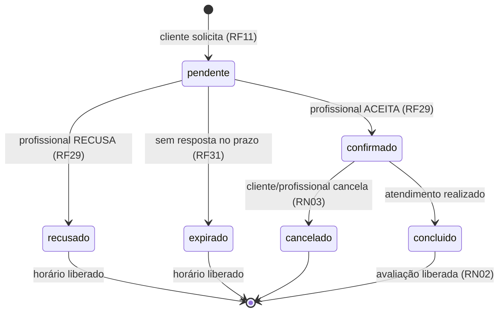

# 📋 Especificação de Requisitos (SPEC)

**Projeto:** App de Agendamento de Serviços de Beleza a Domicílio para Pessoas com Dificuldade de Mobilidade
**Versão:** 1.4 · **Status:** Ativa · **Última atualização:** 2026-11-08
**Documento base:** `documentacao.pdf` (v1.0) · **Governança:** `docs/CONSTITUTION.MD` (v1.3)
**Plataforma da versão atual:** React Native + Expo (Android) + **SQLite local/Drizzle** como cache; **Supabase** (PostgreSQL, Auth, Storage, Realtime e Edge Functions) como banco e API.

> **Como ler este documento.** Seção 1–2: contexto. Seção 3–5: *o quê* (RF, RNF, RN). Seção 6–7: regras críticas de precificação e estados. Seção 8: *quem faz* (casos de uso). Seção 9: *como é representado* (domínio). Seção 10: rastreabilidade. Seção 12: como comprovar entrega.
> Alterações só entram pela seção 13 (*Registro de Mudanças*).

---

## 1. Visão Geral

### 1.1 Objetivo
Permitir que o usuário localize profissionais de beleza próximos à sua residência e agende serviços **a domicílio**, com foco em pessoas com dificuldade de mobilidade, oferecendo um canal centralizado, acessível e seguro de busca, agendamento e comunicação.

### 1.2 Problema Identificado
- Idosos, pessoas com deficiência física e pós-cirúrgicos têm dificuldade de se deslocar até salões, barbearias e espaços de estética.
- Não há canal centralizado para localizar profissionais autônomos que atendam a domicílio.
- O agendamento é informal (telefone/WhatsApp), sem filtro por distância, disponibilidade ou tipo de serviço, e sem histórico/comunicação unificados.

### 1.3 Diretrizes centrais da versão atual (v1.4)
1. **Deslocamento tem preço definido pelo profissional** por faixas de distância (RF26).
2. **O profissional limita a distância que atende** (RF27) e nunca recebe solicitações além dela (RF30).
3. **O profissional aceita ou recusa cada solicitação** (RF12 + RF29), sob prazo de resposta (RF31).
4. **Arquitetura Supabase:** o **Supabase PostgreSQL** é a fonte de verdade; o **SQLite local** é cache/outbox; o app acessa dados **somente pela API do Supabase** (PostgREST, RPC, Storage e Realtime), com RLS (seção 2.4).
5. **Offline para leitura, online para decisão:** dados podem ser consultados offline, mas **escritas críticas são confirmadas pelo Supabase** (RN18/RN19).

## 2. Escopo e Atores

### 2.1 Atores
| Ator | Descrição |
|------|-----------|
| **Cliente** | Busca e agenda serviços de beleza. |
| **Profissional (autônomo)** | Presta serviços de beleza a domicílio; configura raio, faixas de deslocamento e agenda. |
| **Administrador** | Aprova ou reprova o cadastro de profissionais. |
| **Sistema** | Ator secundário: calcula distância/valor, expira solicitações, notifica, bloqueia agenda. |

### 2.2 Dentro do escopo
Cadastro (cliente/profissional/admin), perfil e endereço único, serviços, agenda do profissional, **configuração de deslocamento (faixas + distância máxima)**, busca por proximidade e filtros, calendário/disponibilidade, **solicitação com cálculo de deslocamento**, **aceite/recusa pelo profissional**, notificações remotas/locais, chat pós-solicitação, avaliação, histórico, relatório do profissional, portfólio, aprovação administrativa, **API Supabase (PostgREST + RPC + Edge Functions)**, **cache SQLite offline**, **sincronização por outbox**, **backup no Supabase e exportação local**.

### 2.3 Fora de escopo → ver seção 11.

### 2.4 Plataforma e arquitetura de dados (v1.4) — Supabase

O aplicativo é **React Native + Expo** para Android e conversa **somente** com a **API do Supabase** por HTTPS, usando o client oficial `supabase-js`. O **Supabase PostgreSQL** é a fonte de verdade; o **SQLite local** (`expo-sqlite` + Drizzle ORM) é cache de leitura, outbox de escrita e geocache — nunca autoridade.

```
Tela/Hook → Supabase Client (supabase-js)
                 ├── PostgREST (CRUD + views)
                 ├── RPC (regras transacionais em PL/pgSQL)
                 ├── Storage (fotos e documentos)
                 └── Realtime (chat e mudanças de status)
                              ↓
                 Supabase PostgreSQL (RLS + constraints)
                              ↓
          SQLite local (cache/outbox) ← resposta confirmada
```

Consequências normativas:
- **Leitura:** consulta o cache SQLite e revalida no Supabase (stale-while-revalidate); offline, exibe o último cache válido sinalizando que pode estar desatualizado (RNF07).
- **Escrita crítica** (solicitar, aceitar, recusar, cancelar, concluir, expirar, aprovar profissional): **exige conexão** e é executada por **funções RPC transacionais**; só muda de estado local após confirmação do Supabase (RN18).
- **Escrita não crítica** (rascunhos, preferências, geocache) pode ir para a outbox e sincronizar depois com idempotência (RN19/RF32).
- **Realtime:** chat e mudanças de status usam canais do **Supabase Realtime**; push continua via **Expo Push** (RNF14), com fallback local.
- **Autenticação:** **Supabase Auth** (e-mail/senha, JWT + refresh, hash bcrypt gerenciado pelo Supabase); a sessão é persistida em `expo-secure-store`. Google permanece fora de escopo (RF02).
- **Regras de negócio:** ficam em **funções PL/pgSQL (RPC)**, constraints, triggers e **Edge Functions**; telas e hooks não decidem negócio.
- **Autorização:** **RLS (Row Level Security)** em todas as tabelas expostas; `auth.uid()` e o papel do usuário definem o acesso. A chave pública (`anon`/publishable) pode ir no bundle; `service_role` nunca vai.
- **Valores monetários** em centavos inteiros; **datas/horas** em `timestamptz` no Postgres e ISO-8601 UTC no SQLite; coordenadas em `geography(Point,4326)` (PostGIS).
- **Backup (RNF06):** PITR/branches do Supabase + exportação local do SQLite como contingência.
- **Segurança:** `service_role`, senha do banco e connection string ficam apenas em Edge Functions/ambiente seguro; o bundle mobile contém apenas URL e chave pública do Supabase.
- **Sincronização multi-dispositivo** é suportada pelo Supabase (RF32); conflitos em estado crítico são resolvidos pelo servidor, nunca por last-write-wins.

---

## 3. Requisitos Funcionais (RF)

### 3.1 Conta e Perfil
- **RF01** — Selecionar tipo de conta no cadastro (Cliente ou Profissional), direcionando para o formulário correspondente.
- **RF02** — Cadastrar cliente via **Supabase Auth** (nome, email, telefone e senha, sem foto). O login é feito com e-mail/senha no Supabase; login via Google fica fora de escopo.
- **RF03** — Cadastrar profissional via **Supabase Auth** (dados pessoais, foto de perfil no **Supabase Storage**, documentos para verificação em **bucket privado**, serviços oferecidos, **configuração de atendimento a domicílio: distância máxima e faixas de deslocamento** — ver RF26/RF27).
- **RF04** — Editar perfil (cliente e profissional).
- **RF05** — Cadastrar/editar serviços oferecidos (tipo, preço, duração).
- **RF22** — Cliente cadastra **um único** endereço estruturado (rua, número, bairro, complemento, CEP), usado em todos os agendamentos.
- **RF23** — Cliente **confirma o uso** do endereço cadastrado ao solicitar agendamento, podendo editá-lo antes de confirmar.

### 3.2 Serviços e Disponibilidade (Profissional)
- **RF06** — Profissional cadastra dias e horários de disponibilidade (agenda).
- **RF19** — Profissional cadastra fotos de trabalhos realizados (portfólio).
- **RF18** — Emitir relatório de atendimentos realizados (profissional).

### 3.3 Busca e Agendamento (Cliente)
- **RF07** — Cliente visualiza calendário do profissional com dias disponíveis em destaque.
- **RF08** — Cliente seleciona um dia e visualiza os horários disponíveis naquele dia.
- **RF09** — Listar profissionais por proximidade (geolocalização), **mais próximos primeiro** e **somente os que atendem na distância do cliente (RF27/RF30)**.
- **RF10** — Filtrar a listagem de profissionais por tipo de serviço.
- **RF11** — Solicitar agendamento de horário, com validação de disponibilidade e conflito **no servidor** (RPC transacional).
- **RF13** — Cancelar agendamento (cliente ou profissional).
- **RF14** — Notificar cliente e profissional sobre confirmação/cancelamento por **notificação push remota** (Expo Push, disparada por Edge Function), com fallback local quando o push não estiver disponível.
- **RF20** — Cliente visualiza o portfólio do profissional ao acessar seu perfil.
- **RF24** — Profissional visualiza **apenas a distância aproximada** até o cliente antes de confirmar o agendamento.
- **RF25** — Profissional visualiza o **endereço completo** do atendimento **após** confirmar o agendamento.
- **RF15** — Chat por agendamento, com mensagens persistidas no Supabase e atualização em tempo real via **Supabase Realtime**.

### 3.4 Deslocamento, aceite e sincronização (v1.1/v1.4)
- **RF26 — Faixas de cobrança de deslocamento.** O profissional cadastra, na **configuração inicial** (e pode editar depois), uma ou mais faixas de deslocamento, cada uma com **limite de distância em km** e **valor em R$** — ex.: *até 5 km = R$ 5,00; até 10 km = R$ 8,00; até 20 km = R$ 12,00*. Os pontos (faixas) são **100% definidos pelo profissional**.
- **RF27 — Distância máxima de atendimento.** O profissional define a **distância máxima (km)** que está disposto a atender. Ela delimita: (a) onde ele aparece na busca; (b) quais solicitações recebe; (c) o teto válido das faixas de deslocamento.
- **RF28 — Cálculo e exibição do valor de deslocamento.** Ao escolher horário/endereço, o sistema calcula a distância aproximada entre a **localização de referência do profissional** e o **endereço do cliente**, seleciona a faixa correspondente e exibe ao cliente: *valor do serviço + valor de deslocamento + total*, antes da confirmação (seção 6).
- **RF29 — Decisão do profissional sobre a solicitação.** Na tela de solicitação pendente, o profissional vê **distância aproximada, valor de deslocamento e total**, e pode **Aceitar** ou **Recusar** (complementa RF12 e RF24). Recusa devolve o horário a *disponível*; aceite bloqueia a agenda (RN07) e libera o endereço completo (RF25).
- **RF30 — Bloqueio por distância máxima.** Solicitações com distância **maior que a distância máxima** do profissional **não são geradas**: o profissional não aparece na listagem do cliente e a tentativa de agendar exibe aviso claro de indisponibilidade.
- **RF31 — Prazo de resposta.** Solicitação sem aceite/recusa dentro do prazo configurado (padrão **24 h**) **expira automaticamente**: horário liberado, status `expirado`, cliente notificado. A expiração é aplicada no **servidor** por função agendada no Postgres (`pg_cron`), mesmo com o app fechado.
- **RF32 — Sincronização offline (cache + outbox).** O app mantém um cache SQLite das entidades necessárias para leitura offline e uma outbox idempotente para escrita não crítica. Ao reconectar, envia a outbox e puxa do Supabase apenas o que mudou (`atualizado_em > cursor`). Conflitos em dados críticos são rejeitados/resolvidos pelo servidor; o app então recarrega o estado autoritativo.

---

## 4. Requisitos Não Funcionais (RNF)

| ID | Requisito |
|----|-----------|
| RNF01 | **Autenticação segura via Supabase Auth:** e-mail/senha com hash gerenciado (bcrypt), JWT de acesso + refresh rotativo e sessão em `expo-secure-store`; bloqueio após inatividade (opcional). |
| RNF02 | Interface acessível: fontes ampliáveis, alto contraste e compatível com leitor de tela. |
| RNF03 | Tempo de resposta da busca por profissionais **< 3 s** (Supabase + cache local), inclusive em condição de cache quente; cold start de Edge Functions deve ser evitado em rotas críticas. |
| RNF04 | Aplicativo funcional em **Android**, construído com **React Native + Expo**. |
| RNF05 | Dados pessoais tratados conforme a **LGPD**, com coleta mínima, **RLS** e controle de acesso no banco, e remoção/exportação pelo usuário. |
| RNF06 | **Backup remoto** no Supabase (PITR/branches) + **exportação local** do SQLite como contingência, com restore testado. |
| RNF07 | **Leitura offline** via cache SQLite; **escritas críticas exigem rede** e confirmação do Supabase; geocodificação com cache local de endereços/CEPs. |
| RNF08 | Compatível com leitores de tela nativos (**TalkBack**) por meio das APIs de acessibilidade do React Native — público-alvo com baixa visão. |
| RNF09 | **Logs de auditoria** persistidos no Supabase PostgreSQL para ações sensíveis (confirmação/cancelamento, aprovação de profissional, **aceite/recusa, expiração e mudanças de tarifa de deslocamento**), com espelho local quando necessário. |
| RNF10 | **Feedback visual em ≤ 1 s** após qualquer ação do usuário (otimista apenas para UI; estado crítico aguarda o Supabase). |
| RNF11 | Fotos de perfil/portfólio no **Supabase Storage** (bucket público com transformação/compressão); documentos sensíveis em **bucket privado** com URL assinada. |
| RNF12 | Suporte a **≥ 1.000 usuários simultâneos**, **≥ 1.000 profissionais** e **≥ 10.000 agendamentos**, com Supabase (PostgREST/RPC), pooler e índices adequados. |
| RNF13 | **Persistência transacional:** Postgres com constraints/transações e migrações versionadas via **Supabase CLI**; SQLite local com foreign keys, WAL e migrações versionadas, com testes de upgrade/restore. |
| RNF14 | **Notificações push** via Expo Push, com registro de tokens por dispositivo (tabela `dispositivo`) e fallback local. |
| RNF15 | **Segurança da API Supabase:** HTTPS, **RLS em todas as tabelas expostas**, rate limits, CORS restrito nas Edge Functions, validação Zod no app/RPC, `service_role` só no servidor e logs com redação de dados sensíveis. |

---

## 5. Regras de Negócio (RN)

### 5.1 Originais (v1.0)
- **RN01** — Um profissional só pode confirmar agendamento em horário livre na própria agenda.
- **RN02** — O cliente só pode avaliar o profissional após o atendimento ser concluído.
- **RN03** — Cancelamento respeita prazo mínimo (ex.: 2 h antes do horário marcado).
- **RN04** — O CPF do profissional é único no sistema.
- **RN05** — Um profissional só oferece atendimento a domicílio se informar o raio/distância de atuação (**atendida por RN10 e RN11**).
- **RN06** — Um cliente não pode ter dois agendamentos sobrepostos no mesmo horário.
- **RN07** — O agendamento **confirmado** bloqueia automaticamente na agenda o intervalo equivalente à duração do serviço.
- **RN08** — O chat só fica disponível após uma solicitação de agendamento.
- **RN09** — O profissional só visualiza o endereço completo após confirmar; antes, apenas **distância aproximada ou bairro**.

### 5.2 Deslocamento, distância, decisão e arquitetura (v1.1/v1.4)
- **RN10 (composição da tarifa)** — O valor de deslocamento é o valor da **menor faixa cujo limite (km) ≥ distância calculada**. Ex.: distância 7,4 km → faixa *até 10 km* → R$ 8,00.
- **RN11 (integridade das faixas)** — Cada faixa pertence a um profissional; deve ter `limite_km > 0`, `valor ≥ 0`, limites **estritamente crescentes e sem sobreposição**; um profissional com atendimento a domicílio ativo possui **≥ 1 faixa**; a **última faixa deve ser igual à distância máxima** (RN12). Faixas são editáveis a qualquer momento.
- **RN12 (distância máxima)** — A distância máxima informada pelo profissional é o **teto de atendimento**: limita a exibição na busca (RF09), o recebimento de solicitações (RF30) e deve ser **≥ último limite de faixa** (validação no formulário e na RPC).
- **RN13 (origem da distância)** — Distância calculada entre a **localização de referência do profissional** e o **endereço do cliente**, via **PostGIS no Supabase** (`ST_Distance`/`ST_DWithin`); sempre exibida como **"aproximada"**. Se o cálculo falhar, a solicitação **não prossegue** (nunca se cobra a cegas).
- **RN14 (congelamento do valor)** — `distância`, `valor_deslocamento` e `total` são **gravados no agendamento no momento da solicitação** e não mudam com edições posteriores das faixas.
- **RN15 (decisão)** — Toda solicitação fica **pendente** até **Aceite**, **Recusa** ou **expiração (RF31)**. Horário fica `reservado` durante a pendência e volta a `disponível` em recusa/expiração.
- **RN16 (exibição ao profissional)** — Antes do aceite o profissional vê apenas **distância aproximada + bairro** e o **valor da tarifa/total**; **nunca** o endereço completo (RN09) e **nunca** dados pessoais além do primeiro nome.
- **RN17 (integridade no servidor)** — Toda escrita que altere agenda, agendamento, valores ou auditoria ocorre em **transação no Supabase PostgreSQL**, via **RPC (PL/pgSQL)** ou operação atômica do PostgREST, com constraints no banco. Valores monetários em **centavos inteiros**; datas em **`timestamptz`**; IDs **UUID**; migrações via **Supabase CLI** não podem perder dados. O SQLite local espelha o schema com as mesmas convenções (centavos, ISO-8601 UTC, `foreign_keys = ON`, WAL).
- **RN18 (autoridade do servidor em escrita crítica)** — Solicitar, aceitar, recusar, cancelar, concluir e expirar só mudam de estado após **confirmação transacional do Supabase (RPC)**. O app pode exibir estado otimista transitório, mas deve reverter e mostrar erro se o Supabase recusar/falhar. O cliente nunca "confirma" um agendamento sozinho.
- **RN19 (idempotência e outbox)** — Toda escrita crítica envia **chave de idempotência**; repetições devolvem o mesmo resultado sem duplicar efeitos. Escritas não críticas usam outbox local com retry exponencial e são descartadas/ajustadas se o servidor rejeitar por conflito.
- **RN20 (resolução de conflitos)** — Em dados críticos, o servidor é a autoridade: conflito de horário/estado retorna erro tipado e o app recarrega o estado atual. **Last-write-wins é proibido** para agendamentos, valores e status.
- **RN21 (isolamento de acesso)** — Cada requisição é autorizada pelo JWT do Supabase e filtrada por **RLS** e por papel (cliente/profissional/admin). O app nunca recebe dados de outro usuário por conveniência de cache.
- **RN22 (minimização do cache local)** — O SQLite guarda apenas o necessário para leitura offline; endereço completo é cacheado somente quando o usuário tem direito (pós-aceite) e é limpo no logout/troca de conta.
- **RN23 (RLS obrigatória)** — Toda tabela dos schemas expostos tem **Row Level Security habilitada** e políticas para `anon`/`authenticated`; acessos privilegiados usam RPC/Edge Functions com validação própria. `service_role` nunca é usada no cliente.

---

## 6. Precificação de Deslocamento — Especificação Detalhada

### 6.1 Configuração inicial do profissional (RF26 + RF27)
Tela **"Meu Atendimento a Domicílio"**, preenchida no onboarding e editável depois:

| Campo | Obrigatório | Validação |
|-------|-------------|-----------|
| Distância máxima de atendimento (km) | Sim | `> 0`; `≥ maior limite de faixa` |
| Faixas de deslocamento (n ≥ 1) | Sim | `limite_km > 0`, `valor ≥ 0`, limites crescentes, sem sobreposição |
| Aceitar agendamento apenas sob confirmação | Sim (fixo `Sim` na versão atual) | Reservado para auto-aceite futuro (seção 11) |
| Prazo de resposta (h) | Não | padrão `24`, entre `1` e `72` |

**Exemplo de saída esperada:**

| Faixa | Limite (km) | Valor (R$) |
|-------|-------------|------------|
| 1 | até 5 | 5,00 |
| 2 | até 10 | 8,00 |
| 3 | até 20 | 12,00 |

*Distância máxima de atendimento: 20 km (= última faixa).*

### 6.2 Algoritmo de cálculo (RF28 / RN10)
```
ENTRADA: distanciaKm, faixas[] (ordenadas por limiteKm crescente), distanciaMaximaKm

1. se distanciaKm > distanciaMaximaKm  -> INDISPONIVEL (RF30)
2. percorrer faixas na ordem:
      se distanciaKm <= faixa.limiteKm -> valorDeslocamento = faixa.valor; SAIR
3. (defensivo) nenhuma faixa casou -> INDISPONIVEL (RF30)
4. total = servico.preco + valorDeslocamento
5. persistir no agendamento: distanciaKm, valorDeslocamento, total (RN14)
```

> **v1.4:** o cálculo é executado **no servidor**, dentro da RPC `solicitar_agendamento`, a partir da localização do endereço e das faixas vigentes no Supabase. O app pode pré-visualizar localmente (módulo compartilhado) para feedback imediato, mas o valor gravado e cobrado é o retornado pelo Supabase; divergência é resolvida a favor do servidor.

### 6.3 Exemplos de aceite
| Distância | Faixa aplicada | Deslocamento | Serviço (ex.: R$ 45,00) | Total |
|-----------|----------------|--------------|--------------------------|-------|
| 3,2 km | até 5 km | R$ 5,00 | R$ 45,00 | **R$ 50,00** |
| 7,4 km | até 10 km | R$ 8,00 | R$ 45,00 | **R$ 53,00** |
| 18,0 km | até 20 km | R$ 12,00 | R$ 45,00 | **R$ 57,00** |
| 25,0 km (> 20 km máx.) | — | — | — | **Indisponível** |

### 6.4 Exibição
- **Cliente (antes de confirmar):** serviço + deslocamento (`R$ 8,00 · até 10 km`) + **total**, com a distância aproximada. Recalcula ao trocar de profissional/endereço.
- **Profissional (antes de decidir):** distância aproximada + bairro + tarifa que será cobrada + total (RN16).
- **Após confirmação:** os mesmos valores aparecem no histórico/relatório (RF17/RF18), imutáveis (RN14).

---

## 7. Estados do Agendamento



Efeitos: `confirmado` → bloqueia agenda (RN07), libera endereço completo (RF25), notifica (RF14). `recusado`/`expirado` → horário volta a `disponível` e cliente é notificado. `concluido` → libera avaliação (RN02) e chat histórico.

> **v1.4:** toda transição é aplicada por **RPC transacional no Supabase** (RN17/RN18); a expiração (`pendente → expirado`) roda por função agendada no Postgres (`pg_cron`), independente do app (RF31). O app reflete o estado retornado pelo Supabase e mantém cópia no cache SQLite.

---

## 8. Casos de Uso

> Transcritos de `documentacao.pdf` seções 7.1–7.5, **com as alterações da v1.1 sinalizadas em ➕** e as adaptações da arquitetura Supabase da v1.4 sinalizadas em ➕supabase. Diagrama visual: PDF seção 7.6.

### 8.1 Conta e Perfil
**CU 1.1 — Selecionar Tipo de Conta**
*Ator:* usuário não autenticado · *Pré:* acessa a tela de cadastro.
Fluxo: 1) seleciona "Cliente" ou "Profissional"; 2) Cliente → formulário simplificado (nome, email, telefone, senha ➕supabase); 3) Profissional → formulário completo (dados pessoais, foto, documentos, serviços, **distância máxima e faixas de deslocamento ➕**).

**CU 1.2 — Cadastro de Cliente**
*Ator:* Cliente · *Pré:* escolheu "Cliente".
Fluxo: 1) email/senha; 2) nome, email, telefone e senha; 3) **Supabase Auth** valida e cria a conta; 4) trigger `handle_new_user` cria o registro em `usuario` e `cliente`; 5) app guarda a sessão no `expo-secure-store` e direciona à tela inicial.

**CU 1.3 — Cadastro de Profissional**
*Ator:* Profissional · *Pré:* escolheu "Profissional".
Fluxo: 1) dados pessoais (nome, CPF, telefone, endereço de referência); 2) foto de perfil (bucket público do **Supabase Storage** ➕supabase); 3) documento de verificação (bucket privado com URL assinada ➕supabase); 4) serviços prestados **+ configuração de deslocamento (distância máxima e faixas) ➕**; 5) salva com status `pendente` no Supabase; 6) administrador ➕supabase aprova/reprova via RPC; 7) após aprovação, notifica via push (Edge Function) e libera o uso.

**CU 1.4 — Login** · *Ator:* Cliente/Profissional. 1) informa e-mail e senha; 2) **Supabase Auth** valida as credenciais; 3) app guarda a sessão JWT/refresh no `expo-secure-store`; 4) direciona à tela inicial do perfil.

**CU 1.5 — Editar Perfil** · *Ator:* Cliente/Profissional. 1) acessa edição; 2) altera nome, foto, descrição, endereço de referência, **distância máxima e faixas de deslocamento ➕**; 3) salva (mudanças de tarifa geram log — RNF09 ➕).

**CU 1.6 — Cadastrar Endereço** · *Ator:* Cliente. 1) seção "Meu Endereço"; 2) CEP, rua, número, bairro, complemento; 3) salva como endereço único usado em todos os agendamentos; 4) editável a qualquer momento.

**CU 1.7 — Aprovar/Reprovar Cadastro de Profissional** · *Ator:* Administrador · *Pré:* cadastro `pendente`. 1) lista pendentes (consulta protegida por RLS); 2) analisa dados e documento (URL assinada); 3) aprova ou reprova; 4) RPC `aprovar_profissional` atualiza status em transação, registra auditoria no Supabase e envia push.

### 8.2 Serviços e Disponibilidade (Profissional)
**CU 2.1 — Cadastrar/Editar Serviço** · 1) seção "Meus Serviços"; 2) adiciona/edita com tipo, preço e duração; 3) salva (PostgREST + RLS).
**CU 2.2 — Cadastrar Disponibilidade (Agenda)** · 1) seção "Minha Agenda"; 2) seleciona dias e horários; 3) salva.
**CU 2.3 — Cadastrar Fotos do Portfólio** · 1) seção "Portfólio"; 2) upload no **Supabase Storage**; 3) salva e exibe no perfil público.
**CU 2.4 — Visualizar Portfólio do Profissional** · *Ator:* Cliente. 1) acessa perfil; 2) galeria exibida.

**CU 2.5 — ➕ Configurar Atendimento a Domicílio (faixas e distância máxima)**
*Descrição:* O profissional define **quanto cobra pelo deslocamento** e **até onde atende**.
*Ator:* Profissional · *Pré:* autenticado, cadastro aprovado (ou no onboarding).
*Fluxo Principal:*
1) Acessa **"Meu Atendimento a Domicílio"** (onboarding ou perfil);
2) Informa a **distância máxima de atendimento (km)**;
3) Cadastra as **faixas de deslocamento** (limite em km + valor em R$), na ordem desejada — ex.: *5 km → R$ 5,00; 10 km → R$ 8,00; 20 km → R$ 12,00*;
4) O sistema valida (RN11, RN12) no app e na RPC `salvar_config_deslocamento`: limites crescentes, sem sobreposição, última faixa = distância máxima;
5) Exibe **prévia de cálculo** (3 exemplos: menor, intermediária e maior faixa) para confirmação;
6) Salva em transação e registra log de auditoria (RNF09).
*Fluxos alternativos:*
- **4a. Validação falha** → mensagem específica ("A última faixa (15 km) deve corresponder à distância máxima (20 km)") e permanece na tela.
- **5a. Sem faixas cadastradas** → o profissional **não pode** ser publicado na busca (RN05/RN11).
*Pós-condição:* faixas e distância máxima vigentes; listagem e cálculos passam a usá-las (RF09, RF28, RF30).

### 8.3 Busca e Agendamento (Cliente)
**CU 3.1 — Listar Profissionais por Proximidade** · 1) tela de busca; 2) identifica localização; 3) chama a RPC `buscar_profissionais` e lista ordenada do mais próximo ao mais distante **e filtrada pela distância máxima de cada profissional ➕**.
**CU 3.2 — Filtrar por Tipo de Serviço** · 1) seleciona tipo (ex.: manicure); 2) lista atualizada com quem oferece o serviço.
**CU 3.3 — Visualizar Calendário de Disponibilidade** · 1) calendário com dias destacados; 2) seleciona dia; 3) horários livres (descontando ocupados).

**CU 3.4 — Solicitar Agendamento** ➕ *atualizado*
*Pré:* cliente selecionou profissional, serviço e horário disponível.
1) Escolhe serviço e horário;
2) Sistema preenche o endereço único, cliente revisa e confirma (RF23);
3) ➕ Sistema calcula **distância aproximada** (RN13) e valida contra a **distância máxima** do profissional (RF30) — se exceder, exibe *"Profissional não atende tão longe"* e interrompe;
4) ➕ Sistema calcula o **valor de deslocamento** pela faixa correspondente (RN10) e exibe **serviço + deslocamento + total** ao cliente (RF28);
5) Cliente confirma → app chama a RPC `solicitar_agendamento` com chave de idempotência; a RPC valida distância, faixas, conflito e grava em transação (RN17/RN18/RF32). Profissional vê apenas **distância aproximada/bairro + tarifa** (RN09, RN16);
6) Horário marcado como **`reservado`** até a decisão, com expiração em 24 h (RF31 ➕) controlada pelo `pg_cron`;
7) App só exibe "solicitação enviada" após confirmação da RPC; offline, bloqueia a ação com mensagem de que é necessário estar online.

**CU 3.5 — Aceitar ou Recusar Solicitação (Profissional)** ➕ *reformula RF12*
*Pré:* existe solicitação `pendente`.
1) Profissional abre a solicitação e vê: **data/hora, serviço, distância aproximada, bairro, valor do deslocamento e total** (RF29, RN16 — sem endereço completo);
2) Escolhe **Aceitar** ou **Recusar**;
3a) **Aceite** → RPC `decidir_agendamento` bloqueia o intervalo em transação (RN07), libera o **endereço completo** (RF25), grava distância/valores (RN14);
3b) **Recusa** → horário volta a `disponível`, status `recusado`;
4) App aguarda confirmação da RPC antes de mudar o estado local (RN18); Edge Function notifica o cliente (RF14) e a RPC registra log (RNF09).

**CU 3.6 — Cancelar Agendamento** · 1) acessa "Próximos Agendamentos"; 2) seleciona cancelar; 3) RPC `cancelar_agendamento` valida prazo mínimo (RN03); 4) cancela em transação e libera o horário; 5) notifica a outra parte (RF14). Offline, o cancelamento é bloqueado até reconectar.

**CU 3.7 — ➕ Expirar Solicitação Sem Resposta (Sistema)**
*Ator:* Sistema (pg_cron no Supabase) · *Pré:* solicitação `pendente` há mais de 24 h (ou prazo configurado).
1) Função agendada `expirar_agendamentos()` muda o status para `expirado` (independe do app estar aberto); 2) libera o horário na agenda; 3) Edge Function envia push ao cliente ("o profissional não respondeu a tempo"); 4) registra log no Supabase (RNF09); 5) app recebe o novo estado via Realtime ou na próxima sincronização.

### 8.4 Comunicação
**CU 4.1 — Conversar via Chat** · *Pré:* existe solicitação de agendamento (RN08) — serve para combinar detalhes (ponto de referência), **nunca para transmitir o endereço**. 1) abre a conversa vinculada; 2) envia mensagens persistidas no Supabase (cache local para leitura offline); 3) a outra parte recebe via **Supabase Realtime** e/ou push; 4) notifica via push quando o app estiver em segundo plano.

### 8.5 Pós-Atendimento
**CU 5.1 — Avaliar Profissional** · *Pré:* atendimento concluído (RN02). 1) solicita nota e comentário opcional; 2) cliente informa; 3) salva no perfil.
**CU 5.2 — Visualizar Histórico** · 1) seção "Histórico"; 2) lista com status (concluído, cancelado, pendente) **e valores de serviço/deslocamento/total ➕**.
**CU 5.3 — Emitir Relatório de Atendimentos** · 1) seleciona período; 2) gera relatório com atendimentos, **valores (incluindo deslocamento) ➕** e avaliações.

---

## 9. Modelo de Domínio

### 9.1 Entidades (atributos **negrito** = novos na v1.1; `➕supabase` = adaptação da v1.4)

> Entidades de domínio têm `id UUID` e `atualizado_em` (`timestamptz`); as sincronizáveis têm `criado_em` e, quando aplicável, `excluido_em` (exclusão lógica). Logs de auditoria são imutáveis (`criado_em` apenas).

**Usuário (conta em `auth.users` + perfil público) ➕supabase:** `id` (= `auth.users.id`), `tipo (cliente|profissional|admin)`, `email (único)`, `ativo`. A senha e o refresh token são gerenciados pelo **Supabase Auth** (sem `senha_hash` no schema público).
**DispositivoPush ➕supabase:** `id`, `usuário (ref)`, `expo_push_token`, `plataforma`, `último_uso_em`, `revogado_em`
**Cliente:** `id`, `usuário (ref)`, `nome`, `telefone`, `endereço (1:1)`
**Endereço:** `id`, `cliente (1:1)`, `cep`, `rua`, `número`, `complemento`, `bairro`, `cidade`, `localização ➕supabase`
**Profissional:** `id`, `usuário (ref)`, `nome`, `cpf`, `telefone`, `foto de perfil (URL do Supabase Storage)`, `documento de verificação (chave no bucket privado ➕supabase)`, `status de verificação (pendente|aprovado|reprovado)`, `endereço de referência`, `raio/distância de atendimento` *(substituído por:* **`distância máxima (km)`** *+* **`faixas []`***)*, `**prazo de resposta (h)**`, `descrição`
**Administrador:** `id`, `usuário (ref)`, `nome`
**FaixaDeslocamento** 🆕: `id`, `profissional (ref)`, `**limite_km**`, `**valor (R$)**`, `ordem`
**Serviço:** `id`, `profissional (ref)`, `tipo`, `preço`, `duração`
**Agenda:** `id`, `profissional (ref)`, `data`, `hora de início`, `hora de fim`, `status (disponível|ocupado|reservado)`
**Agendamento:** `id`, `cliente (ref)`, `profissional (ref)`, `serviço (ref)`, `endereço (ref)`, `início`, `fim`, `status (pendente|confirmado|recusado|cancelado|concluído|`**`expirado`**`)`, **`distância (km)`**, **`valor de deslocamento`**, **`total`**, **`solicitado em`**, **`responder até`**, **`decidido em`**, `chave_idempotencia (única)`
**Avaliação:** `id`, `agendamento (ref)`, `nota`, `comentário`, `data`
**Mensagem:** `id`, `agendamento (ref)`, `remetente`, `conteúdo`, `enviada em`
**Foto do Portfólio:** `id`, `profissional (ref)`, `url do Supabase Storage`, `enviada em`
**LogAuditoria:** `id`, `ator (ref)`, `ação`, `entidade`, `entidade_id`, `detalhe`, `criado em`

**Entidades locais (apenas SQLite) ➕v1.4:**
**SyncCursor:** `entidade`, `ultimo_atualizado_em`, `ultimo_sync_em`
**Outbox:** `id`, `entidade`, `operacao`, `payload_json`, `chave_idempotencia`, `tentativas`, `proxima_tentativa_em`, `status (pendente|enviando|falhou|concluido)`
**GeocodeCache:** `consulta_hash`, `endereco_normalizado`, `latitude`, `longitude`, `expira_em`

### 9.2 Relacionamentos
- Cliente → solicita → Agendamento · Cliente → possui (1:1) → Endereço
- Endereço → referenciado em → Agendamento
- Profissional → oferece → Serviço · Profissional → define → Agenda
- Profissional → **define (1:N) → FaixaDeslocamento** 🆕
- Profissional → possui → Foto do Portfólio · Profissional → atende → Agendamento
- Serviço → compõe → Agendamento · Agendamento → gera → Avaliação · Agendamento → contém → Mensagem

### 9.3 Diagrama ER

```mermaid
erDiagram
    CLIENTE ||--|| ENDERECO : "possui 1:1"
    CLIENTE ||--o{ AGENDAMENTO : solicita
    ENDERECO ||--o{ AGENDAMENTO : "referenciado em"
    PROFISSIONAL ||--o{ SERVICO : oferece
    PROFISSIONAL ||--o{ AGENDA : define
    PROFISSIONAL ||--o{ FAIXA_DESLOCAMENTO : "define 1:N"
    PROFISSIONAL ||--o{ FOTO_PORTFOLIO : possui
    PROFISSIONAL ||--o{ AGENDAMENTO : atende
    SERVICO ||--o{ AGENDAMENTO : "compõe"
    AGENDAMENTO ||--o| AVALIACAO : gera
    AGENDAMENTO ||--o{ MENSAGEM : contém
    FAIXA_DESLOCAMENTO {
      uuid id PK
      uuid profissional_id FK
      decimal limite_km
      int valor_centavos
      int ordem
    }
    PROFISSIONAL {
      uuid id PK
      string cpf UQ
      decimal distancia_maxima_km
      int prazo_resposta_h
    }
    AGENDAMENTO {
      uuid id PK
      string status
      decimal distancia_km
      int valor_deslocamento_centavos
      int total_centavos
      timestamptz responder_ate
      string chave_idempotencia UQ
    }
```

### 9.4 Convenções de persistência (v1.4) — Supabase (autoridade) + SQLite (cache)

| Aspecto | Supabase PostgreSQL (fonte de verdade) | SQLite local (`expo-sqlite` + Drizzle) |
|---------|----------------------------------------|----------------------------------------|
| Papel | Autoridade de dados compartilhados | Cache de leitura + outbox + geocache |
| Identificadores | `UUID` (`gen_random_uuid()`) | `TEXT` com o mesmo UUID |
| Dinheiro | `INTEGER` em **centavos** | `INTEGER` em **centavos** |
| Distância | `NUMERIC(6,2)` km; localização `GEOGRAPHY(Point,4326)` | `REAL` km; latitude/longitude `REAL` |
| Data/hora | `TIMESTAMPTZ` | `TEXT` ISO-8601 UTC (`AAAA-MM-DDTHH:mm:ss.sssZ`) |
| Data de agenda | `DATE`; horas `TIME` | `TEXT` `AAAA-MM-DD`; hora `HH:mm` |
| Booleano | `BOOLEAN` | `INTEGER` `0/1` com `CHECK` |
| Autenticação | **Supabase Auth** (`auth.users`, JWT, refresh); perfil em `public.usuario` | Sessão em `expo-secure-store`; sem senha |
| Autorização | **RLS** + `auth.uid()` + `service_role` só em Edge Functions | Respeita o que o servidor devolveu; nunca eleva privilégio |
| Imagens/documentos | **Supabase Storage** (bucket público para portfólio; privado para documentos; URL assinada) | Apenas URLs/caminhos de cache; sem documento sensível persistido |
| Migrações | **Supabase CLI** (`supabase migration`, `supabase db push`) | `drizzle-kit` para SQLite + migrations versionadas |
| Integridade | `FK`, `CHECK`, `UNIQUE`, **exclusion constraint** (`btree_gist` + `tstzrange`), triggers | `PRAGMA foreign_keys = ON`; `journal_mode = WAL`; validação também na aplicação |
| Concorrência | Transações em RPC + constraints + `SELECT ... FOR UPDATE` | `BEGIN IMMEDIATE` para outbox; nunca decide conflito crítico sozinho |
| Tempo real | **Supabase Realtime** (chat e status) | Atualiza cache ao receber evento; fallback por polling |
| Sincronização | `atualizado_em`, `excluido_em`, cursor por entidade | `sync_state` + `outbox` + `chave_idempotencia` |
| Backup | PITR/branches do Supabase | Exportação do arquivo `.db` (contingência — RNF06) |
| Segredos | `service_role`/connection string só em Edge Functions; `anon` no app | Sem credenciais de banco; só URL e chave pública do Supabase |

**Regra de ouro:** se o SQLite e o Supabase divergirem, o Supabase vence. O app descarta o cache conflitante e recarrega do servidor (RN20).

---

## 10. Matriz de Rastreabilidade (RF ↔ RN ↔ CU)

| RF | RN | CU | Teste mínimo |
|----|----|----|--------------|
| RF01–RF02 | RN23 | 1.1, 1.2 | cadastro completo/incompleto; trigger cria perfil |
| RF03 | RN04, RN05, RN23 | 1.3, **2.5** | CPF duplicado; sem faixa ⇒ não publicado |
| RF04 | — | 1.5 | editar dist. máxima e tarifas + log |
| RF05 | — | 2.1 | serviço com duração/preço inválidos |
| RF06 | RN01 | 2.2 | horário livre obrigatório |
| RF07–RF08 | RN07 | 3.3 | horário ocupado não aparece |
| RF09 | **RN12**, **RN10**, RN23 | 3.1 | ordenação + filtro por distância máxima |
| RF10 | — | 3.2 | filtro por serviço |
| RF11 | RN14, RN17/RN18 | 3.4 | conflito de horário recusado pela RPC; idempotência |
| RF12/RF29 | **RN15**, RN09, **RN16**, RN18 | 3.5 | aceite bloqueia agenda em transação; recusa libera |
| RF13 | RN03, RN18 | 3.6 | cancelamento fora do prazo negado; offline bloqueado |
| RF14 | RN18 | 3.5, 3.6, **3.7** | push em cada transição + fallback local |
| RF15 | RN08 | 4.1 | chat só após solicitação; RLS de participantes |
| RF16 | RN02 | 5.1 | avaliação antes do fim negada |
| RF17/RF20 | — | 5.2, 2.4 | histórico e portfólio |
| RF18 | — | 5.3 | relatório com valores |
| RF19 | RNF11 | 2.3 | upload + compressão (Storage) |
| RF21 | RN23 | 1.7 | aprovação/reprovação + notificação |
| RF22–RF23 | RN23 | 1.6, 3.4 | endereço único revisado |
| RF24/RF25 | RN09 | 3.5 | endereço completo só pós-aceite |
| **RF26** | **RN11** | **2.5** | faixas inválidas rejeitadas |
| **RF27** | **RN12** | **2.5** | máx. < última faixa ⇒ erro |
| **RF28** | **RN10**, RN13 | 3.4 | tabela de exemplos (seção 6.3) |
| **RF30** | **RN12** | 3.1, 3.4 | 25 km ⇒ indisponível |
| **RF31** | **RN15**, RN18 | 3.7 | expiração em 24 h no pg_cron libera horário |
| **RF32** | **RN19**, **RN20**, **RN22** | 3.4, 3.5 | outbox idempotente; conflito rejeitado; pull por cursor |

---

## 11. Fora de Escopo (v1.4) e Trabalhos Futuros

**Não será construído agora:** sistema de denúncias/suporte; vínculo com salões/estabelecimentos; suporte a iOS; **aceite automático de agendamento**; **pagamento/in-app checkout**; múltiplos endereços por cliente; IPTAX/geocodificação offline própria; **login Google**; **criptografia do banco local (SQLCipher)**; **modo totalmente offline com escrita crítica**; **sincronização peer-to-peer**.

**Trabalhos futuros (herdados do PDF seção 12 + v1.1 + v1.4):**
- Denúncias e moderação de contas.
- Vínculo com salões/estabelecimentos.
- Suporte a iOS.
- **Aceite automático** opcional pelo profissional (o campo já existe na configuração, seção 6.1).
- **Promoções/faixas sazonais** e deslocamento por rota real (não por distância em linha reta).
- Repasse/pagamento integrado do valor de deslocamento.
- **Login Google** e autenticação federada (quando habilitado no Supabase Auth).
- **Criptografia em repouso** do SQLite (SQLCipher) e rotação automática de chaves.
- **Branches de banco do Supabase** para preview por PR (quando o plano permitir).

---

## 12. Critérios de Aceite Globais

1. Todo RF da seção 3 possui ao menos um teste automatizado de regra de negócio (seção 10).
2. Tabela da seção 6.3 reproduzida exatamente em teste unitário.
3. Nenhuma tela com TalkBack anunciando elementos sem rótulo; contraste AA.
4. Endereço completo ausente de qualquer resposta do Supabase antes do status `confirmado` (**RLS + view/RPC de autorização no banco**, não só na UI) e não cacheado além do direito do usuário.
5. **Leitura offline** via SQLite (RNF07) e busca < 3 s (RNF03) com 1.000 profissionais; **escrita crítica sem rede é bloqueada** com mensagem clara.
6. Log de auditoria no Supabase para: aprovação de profissional, aceite/recusa, expiração, cancelamento, alteração de faixas/distância máxima.
7. **Backup/restore** do Supabase (PITR/branch) e exportação local reproduzem estado consistente e testado (RNF06).
8. **Concorrência:** duas solicitações simultâneas para o mesmo horário resultam em exatamente uma confirmada e a outra rejeitada com erro tipado (RN17/RN18).
9. **Idempotência:** repetir a mesma requisição crítica (mesma chave) não duplica agendamento, cobrança ou notificação.
10. **Segurança:** `service_role`, connection string e senha do banco ausentes do bundle mobile; **RLS habilitada e testada** em todas as tabelas expostas; políticas para `anon` e `authenticated` verificadas.
11. **Migração de schema** via Supabase CLI preserva dados e é executada em transação (RNF13/RN17).
12. Nenhuma tela escreve SQL direto: acesso passa pelo **Supabase Client/RPC**, regras ficam no banco/Edge Functions.
13. **RLS:** nenhum acesso retorna dados de outro usuário; testes por perfil (anônimo, cliente, profissional, admin) passam.

---

## 13. Registro de Mudanças

| Versão | Data | Alteração | RF/RN afetados |
|--------|------|-----------|----------------|
| 1.0 | — | Especificação inicial transcrita de `documentacao.pdf` (RF01–RF25, RNF01–RNF12, RN01–RN09, CUs 1.1–5.3). | — |
| **1.1** | **2026-10-29** | **Adicionado:** cobrança de deslocamento por faixas definidas pelo profissional; distância máxima de atendimento; aceite/recusa pelo profissional com prazo de resposta e status `expirado`. | RF26–RF31, RN10–RN16, CU 2.5, CU 3.7; CUs 1.1, 1.3, 1.5, 3.1, 3.4, 3.5, 5.2, 5.3 atualizados |
| **1.2** | **2026-10-29** | **Adaptação para React Native + Expo com SQLite local:** operação offline, notificações locais, login local e ausência de backend. Ajustados RNF03, RNF06, RNF07, RNF09, RNF12, RNF13; adicionados RN17/RN18 e convenções de persistência (9.4). | RF02, RF03, RF14, RF31; RNF01–RNF13; RN17–RN18; CU 1.1, 1.2, 1.3, 1.4, 1.7, 3.7, 4.1; §2.4, §9.4, §11, §12 |
| **1.3** | **2026-10-29** | **Arquitetura híbrida:** Neon PostgreSQL como fonte de verdade, API Express/TypeScript no Render, SQLite/Drizzle como cache/outbox; login server-side, push Expo, uploads Cloudinary/bucket privado, sincronização idempotente e autoridade do servidor em escritas críticas. | RF02, RF03, RF11, RF14, RF31, **RF32**; RNF01–RNF15; RN17–RN22; CU 1.1–1.4, 1.7, 3.4–3.7, 4.1; §2.4, §7, §9.1–9.4, §10, §11, §12 |
| **1.4** | **2026-11-08** | **Backend consolidado no Supabase:** PostgreSQL, Auth, Storage, Realtime e Edge Functions substituem Neon + API Express/Render e Cloudinary; RPC transacional para escritas críticas; RLS obrigatória (RN23); `pg_cron` para expiração; PostGIS para distância; sincronização e chat com Realtime. | RF02, RF03, RF11, RF14, RF15, RF19, RF28, RF31, RF32; RNF01–RNF15; RN13, RN17–RN23; CU 1.2–1.4, 1.7, 2.3, 3.1, 3.4–3.7, 4.1; §1.3, §2.2, §2.4, §6.2, §7, §9, §10, §11, §12 |
