# Análise das Dependências Críticas — `docs/TASK.md`

**Projeto:** App de Agendamento de Serviços de Beleza a Domicílio
**Documento analisado:** `docs/TASK.md` (v2.0 — 2026-10-29)
**Documentos de apoio:** `docs/SPEC.md` (v1.3), `docs/PLAN.md` (v3.0), `docs/CONSTITUTION.MD` (v1.2)
**Objetivo:** explicar por que cada elo da seção **“Dependências críticas (trilha da v1.3)”** é crítico, o que ele desbloqueia, o risco de antecipá-lo e como usá-lo como gate de execução.

---

## 1. Resumo executivo

Com a arquitetura híbrida, a trilha crítica protege **cinco** propriedades do produto:

1. **Base técnica confiável** — sem monorepo, API, Neon, Drizzle e contratos compartilhados, nenhuma tela ou regra pode ser validada de verdade.
2. **Identidade e autorização** — o servidor precisa saber *quem* é o usuário antes de expor ou alterar qualquer dado.
3. **Precificação correta e auditável** — o cálculo de distância/faixa e o congelamento dos valores ocorrem no servidor; errar aqui gera cobrança indevida.
4. **Máquina de estados íntegra** — reserva de agenda, aceite/recusa, expiração e auditoria precisam acontecer na ordem e na mesma transação no Neon.
5. **Sincronização segura** — o SQLite local é cache/outbox; sem pull/push idempotente e resolução de conflito, o app mostra ou grava estado divergente.

A cadeia mais longa do diagrama tem cerca de **22 nós** (21 dependências):

```
T001 → T003 → T004 → T005 → T102 → T104 → T105 → T106 → T112 → T302 →
T303 → T403 → T405 → T406 → T408 → T412 → T415 → T501 → T502 → T503 → T710
```

A branch de precificação (`T006 → T401 → T402`) corre em paralelo e desemboca em `T403`; a de endereço (`T103 → T109`) também é entrada obrigatória de `T403`.

Qualquer atraso nessa cadeia atrasa o release `v1.3`. As ramificações de **visibilidade geográfica**, **notificação/push**, **backup/migração** e **segurança** são igualmente críticas por risco de negócio, mesmo quando não alongam a cadeia principal.

---

## 2. Como ler a trilha

| Notação | Significado |
|---------|-------------|
| `A → B` | `B` depende de `A`; `B` só deve iniciar depois que `A` estiver com DoD completo |
| `A/B` | Duas tarefas independentes entre si, ambas necessárias para o próximo elo |
| Elo de **fundação** | Sem ele, não há ambiente confiável para o restante |
| Elo de **autorização** | Sem ele, dados ficam expostos ou alteráveis por quem não deveria |
| Elo de **correção** | Sem ele, o sistema pode calcular, gravar ou exibir algo errado |
| Elo de **integridade** | Sem ele, o estado do agendamento/agenda pode ficar inconsistente |
| Elo de **privacidade** | Sem ele, dados sensíveis podem vazar antes da hora |
| Elo de **sincronização** | Sem ele, cache e servidor divergem |
| Elo de **release** | Sem ele, não há evidência mínima para publicar |

Regra prática: **dependência não é sugestão de ordem; é contrato de entrada.** Iniciar uma tarefa sem o insumo estável tende a gerar retrabalho, mocks que divergem da realidade ou dados inconsistentes no Neon/SQLite.

---

## 3. Visão comentada do grafo

```mermaid
flowchart LR
    subgraph Fundacao["Fundação"]
        T001[T001 Monorepo] --> T003[T003 API Express]
        T003 --> T004[T004 Neon + Pool]
        T004 --> T005[T005 Drizzle/Migrations]
        T001 --> T002[T002 Expo]
        T001 --> T006[T006 Shared/Zod]
    end

    subgraph Identidade["Identidade e perfil"]
        T005 --> T102[T102 Auth/JWT]
        T102 --> T104[T104 Cadastro profissional]
        T104 --> T105[T105 Faixas/máx.]
        T105 --> T106[T106 Validações]
        T106 --> T112[T112 Sem faixa = oculto]
    end

    subgraph Busca["Busca e elegibilidade"]
        T112 --> T302[T302 Busca/geo API]
        T302 --> T303[T303 Listagem filtrada]
    end

    subgraph Preco["Precificação"]
        T006 --> T401[T401 DeslocamentoService]
        T401 --> T402[T402 Testes §6.3]
    end

    subgraph Solicitacao["Solicitação"]
        T303 --> T403[T403 POST idempotente]
        T402 --> T403
        T403 --> T405[T405 Congelar valores]
    end

    subgraph Decisao["Reserva e decisão"]
        T405 --> T406[T406 Reserva/constraints]
        T405 --> T407[T407 Visão do profissional]
        T406 --> T408[T408 Aceitar/Recusar]
        T407 --> T408
    end

    subgraph Fechamento["Fechamento"]
        T408 --> T410[T410 Expiração servidor]
        T408 --> T411[T411 Cancelamento]
        T408 --> T412[T412 Auditoria]
        T410 --> T412
        T411 --> T412
        T412 --> T415[T415 Pull inicial]
    end

    subgraph Sync["Sync e push"]
        T415 --> T501[T501 SQLite/outbox]
        T501 --> T502[T502 SyncService]
        T502 --> T503[T503 Conflito autoritativo]
        T408 --> T505[T505 Push]
        T503 --> T710[T710 Release]
        T505 --> T710
    end

    subgraph Backup["Backup e migração"]
        T005 --> T704[T704 Backup/restore]
        T501 --> T704
        T704 --> T711[T711 Upgrade schema]
        T711 --> T710
    end
```



> O diagrama acima expande a trilha do `TASK.md` com as dependências de suporte que explicam os caminhos. As caixas `T305`, `T504` e `T710` recebem dependências adicionais descritas na seção 5.

---

## 4. Análise elo a elo

### 4.1 Fundação: `T001 → T002/T003 → T004 → T005` + `T006`

| Elo | Por que é crítico | O que acontece se for invertido/antecipado |
|-----|-------------------|---------------------------------------------|
| **T001 → T002/T003** | O monorepo define workspaces, `tsconfig` base, aliases e onde vivem app, API e contratos. Sem isso não há padrão de imports nem pipeline único. | App e API criados “soltos” geram retrabalho de mover arquivos, duplicar tipos e quebrar o CI. |
| **T003 → T004** | A API Express é o único caminho até o Neon (C15). O pool `pg` só deve existir dentro dela. | Colocar acesso ao banco no app viola a Constituição e expõe `DATABASE_URL` no bundle. |
| **T004 → T005** | Schema, constraints e migrations dependem do Neon provisionado e do pool configurado. | Migrations geradas sem banco real testam um alvo fictício; constraints críticas ficam sem validação. |
| **T005 → T102** | Login, refresh, autorização e todas as rotas precisam das tabelas `usuario`/`sessao_dispositivo`. | Autenticação improvisada sobre schema instável gera migrações destrutivas e tokens sem revogação. |
| **T001 → T006** | Contratos Zod e o módulo de deslocamento são a linguagem comum entre app e API. | Cada lado define seu próprio DTO; a divergência só aparece em produção. |
| **T006 → T401** | `DeslocamentoService` é puro, mas depende dos tipos/formatos compartilhados (centavos, km, faixas). | Fórmula duplicada no app e na API, com arredondamentos diferentes. |

**Criticidade:** é a base de tudo. Um erro aqui contamina todos os marcos seguintes. O DoD exige integração contra Postgres real justamente porque a confiança no schema/constraints precisa ser provada cedo.

---

### 4.2 Identidade e perfil: `T005 → T102 → T104 → T105 → T106 → T112`

| Elo | Por que é crítico | O que acontece se for invertido/antecipado |
|-----|-------------------|---------------------------------------------|
| **T005 → T102** | `T102` implementa hash, JWT, refresh rotativo e revogação sobre as tabelas de usuário/sessão. | Sem auth, qualquer rota de perfil fica aberta; depois é caro inserir autorização em todas as telas. |
| **T102 → T104** | O cadastro profissional precisa de um usuário autenticado e de upload seguro de documento. | Cadastro anônimo ou documento público viola RN09/LGPD e a C18. |
| **T104 → T105** | `T105` coleta distância máxima e faixas do profissional já existente. | Faixas órfãs, sem dono, contaminam busca e cálculo. |
| **T105 → T106** | `T106` valida limites crescentes, ausência de sobreposição e última faixa = distância máxima (RN11/RN12). | Dados inválidos entram no Neon e contaminam busca, cálculo e cobrança. |
| **T106 → T112** | Publicar só depois de faixas válidas garante que ninguém apareça na busca sem tarifa. | Profissional sem faixa é listado e a solicitação falha no cálculo (RN05/RN11). |

**Criticidade:** é o elo de **autorização + elegibilidade**. Sem ele, o servidor não sabe quem é o profissional nem se ele pode ser apresentado ao cliente.

---

### 4.3 Busca e elegibilidade: `T112 → T302 → T303`

| Elo | Por que é crítico | O que acontece se for invertido/antecipado |
|-----|-------------------|---------------------------------------------|
| **T112 → T302** | A busca no servidor só deve considerar profissionais com faixas válidas e aprovados. | Índices e queries são construídos sobre um conjunto que inclui perfis inválidos; o filtro vira gambiarra na UI. |
| **T302 → T303** | `T303` ordena por proximidade e filtra pela distância máxima usando haversine/índices no servidor. | Ordenação/filtro no app exigiria baixar a base inteira e divergiria da autoridade do servidor. |

**Criticidade:** é o elo de **elegibilidade geográfica**. Ele impede que o cliente solicite um serviço que o profissional não atende e que o profissional apareça fora da área.

---

### 4.4 Precificação: `T006/T401 → T402`

| Elo | Por que é crítico | O que acontece se for invertido/antecipado |
|-----|-------------------|---------------------------------------------|
| **T006 → T401** | O módulo puro precisa dos tipos compartilhados e da regra da SPEC §6.2. | A fórmula vira código solto na UI, sem contrato com a API. |
| **T401 → T402** | `T402` é o **gate de precificação**: reproduz exatamente a tabela da SPEC §6.3 (3,2 km, 7,4 km, 18 km, 25 km) e as fronteiras. | Valores errados chegam ao cliente/profissional; a regressão futura fica sem rede de proteção. A Constituição §5 exige teste antes de liberar qualquer mudança de valor. |

**Criticidade:** é o coração do escopo e a principal fonte de risco financeiro. `T402` não é “teste depois”: é o critério que autoriza `T403` a gravar preços.

---

### 4.5 Solicitação: `T303 + T401/T402 + T109 → T403 → T405`

| Elo | Por que é crítico | O que acontece se for invertido/antecipado |
|-----|-------------------|---------------------------------------------|
| **T303/T401/T402 → T403** | `T403` é o `POST /agendamentos` idempotente: valida endereço, distância, faixa e conflito, e grava em transação. Precisa da busca/elegibilidade e da fórmula validada. | A API pode aceitar solicitação fora da área ou com total divergente do exibido. |
| **T403 → T405** | `T405` persiste `distancia_km`, `valor_deslocamento_centavos` e `total_centavos` congelados (RN14) na mesma transação. | Se a persistência vier antes, não há definição de “quando” congelar; se vier depois, agendamentos antigos ficam sem valores e exigem migração corretiva. |
| **T109 → T403** | O endereço único revisável é a entrada do cálculo de distância (RF23). | Sem endereço, a API não calcula distância nem valida a distância máxima. |

**Criticidade:** `T405` é o ponto em que o valor deixa de ser cálculo e passa a ser **registro imutável** no Neon. É a base de histórico, relatório, auditoria e defesa do cliente.

---

### 4.6 Reserva e decisão: `T405 → T406/T407 → T408`

| Elo | Por que é crítico | O que acontece se for invertido/antecipado |
|-----|-------------------|---------------------------------------------|
| **T405 → T406** | A reserva (`pendente` ⇒ `reservado`) e as constraints de sobreposição precisam ocorrer junto com a criação do agendamento com valores congelados, na mesma transação (RN15/RN17). | Sem valores persistidos, a reserva pode existir sem lastro; sem transação/constraints, dois agendamentos podem ocupar o mesmo horário. |
| **T405 → T407** | O profissional só pode decidir vendo **distância aproximada + bairro + tarifa + total** (RF29/RN16). Esses dados vêm do agendamento persistido. | A tela de decisão pode expor endereço completo ou mostrar tarifa recalculada, violando RN09/RN14. |
| **T406 + T407 → T408** | `T408` (Aceitar/Recusar) é a transição central da máquina de estados. Exige horário já reservado e visão correta do profissional. | Se `T408` vier antes, o aceite pode bloquear um horário que não estava reservado ou liberar endereço sem contexto de decisão. |

**Criticidade:** é o elo de **integridade + privacidade**. `T406` protege a agenda contra sobreposição via `EXCLUDE USING gist`; `T407` protege o endereço; `T408` materializa RF25/RF29 e é onde o app aprende a **não confirmar localmente** (RN18).

> Observação: `T406` também depende de `T202` (agenda cadastrada) e `T407` depende de `T405`. Essas dependências de suporte são condições de entrada, não detalhes opcionais.

---

### 4.7 Fechamento do ciclo: `T408 → T410/T411/T412 → T415`

| Elo | Por que é crítico | O que acontece se for invertido/antecipado |
|-----|-------------------|---------------------------------------------|
| **T408 → T410** | A expiração é um job transacional no servidor que libera horário `reservado` e muda para `expirado` (RF31). | Expirar antes da reserva pode liberar horário errado; expirar no app não funciona com o app fechado. |
| **T408 → T411** | Cancelamento valida prazo mínimo e libera a agenda em transação (RN03). | Cancelar sem transação pode deixar o horário preso ou liberar duas vezes. |
| **T408 + T410 + T411 → T412** | A auditoria deve registrar **solicitação, aceite, recusa, expiração e cancelamento**. Se for feita antes, o log fica incompleto. | Auditoria parcial não atende RNF09 nem o critério global 6 da SPEC §12. |
| **T412 → T415** | O pull inicial do app só deve cachear um estado já auditado e consistente. | Cachear antes da auditoria pode esconder transições e dificultar a reconciliação. |

**Criticidade:** é o elo de **conformidade**. A máquina de estados só está completa quando todas as saídas (`confirmado`, `recusado`, `expirado`, `cancelado`) têm efeito, notificação e auditoria.

---

### 4.8 Sincronização e push: `T415 → T501 → T502 → T503` + `T504 → T505`

| Elo | Por que é crítico | O que acontece se for invertido/antecipado |
|-----|-------------------|---------------------------------------------|
| **T415 → T501** | O schema SQLite local (cache + `sync_state` + `outbox`) é desenhado a partir do que o pull inicial traz. | Criar tabelas locais antes de saber o contrato de pull gera migrations descartáveis. |
| **T501 → T502** | `SyncService` implementa pull por `atualizado_em` e push idempotente da outbox. | Sem outbox, retries duplicam escritas; sem cursor, o app baixa a base inteira ou perde mudanças. |
| **T502 → T503** | A resolução de conflito precisa do fluxo de sync para detectar `409` e recarregar o estado autoritativo. | “Last-write-wins” local sobrescreve decisão do servidor e quebra RN18/RN20. |
| **T504 → T505** | O token Expo Push precisa estar registrado por dispositivo antes de o servidor notificar. | Push sem token válido falha silenciosamente; o usuário perde solicitações/aceites. |

**Criticidade:** é o elo de **consistência distribuída**. O app é offline-capable, mas o servidor continua autoritativo; a outbox é o único caminho aceitável para escrita não crítica.

---

### 4.9 Backup e migração: `T005/T501 → T704 → T711 → T710`

| Elo | Por que é crítico | O que acontece se for invertido/antecipado |
|-----|-------------------|---------------------------------------------|
| **T005 → T704** | Backup do Neon (PITR/branch) e exportação local só podem ser testados sobre schemas reais. | Backup de schema fictício não prova nada; restore pode falhar no schema real. |
| **T501 → T704** | O backup local de contingência depende do schema SQLite e do fluxo de sync. | Exportar um cache incompleto dá falsa sensação de backup. |
| **T704 → T711** | `T711` testa upgrade de schema com rollback. Sem `T704`, não há como garantir recuperação antes de uma migração destrutiva. | Migração sem restore testado pode corromper dados no Neon ou no dispositivo. |
| **T711 → T710** | O release precisa da evidência de que uma atualização preserva dados. | Publicar sem teste de upgrade arrisca perder histórico na primeira atualização. |

**Criticidade:** no modelo híbrido, o Neon tem PITR, mas o SQLite ainda é o estado visível ao usuário. Backup/migração continuam sendo requisitos de sobrevivência (RNF06/RNF13), não infraestrutura opcional.

---

## 5. Dependências de suporte que também são críticas

| Dependência | Alimenta | Por que importa |
|-------------|----------|-----------------|
| `T001 → T002` | App Expo | Sem scaffold, não há telas, nem SecureStore, nem cache local. |
| `T102 → T103` | `ApiClient` + tokens | Sem login no app, nenhuma rota autenticada é exercitada ponta a ponta. |
| `T103 → T109` | Endereço do cliente | O endereço é criado por usuário autenticado. |
| `T202 → T406` | Reserva de agenda | Sem agenda cadastrada, não há horário para reservar. |
| `T301 → T302/T303` | Busca por proximidade | Sem geocodificação/cache, a distância não é calculável de forma estável. |
| `T109 → T403` | Solicitação | Sem endereço único revisável, não há distância nem confirmação (RF23). |
| `T406 → T413` | Teste de sobreposição | Só faz sentido depois que a reserva e as constraints existem; valida RN06/RN17. |
| `T406 + T408 + T410 → T414` | Testes de concorrência/idempotência | Só é possível testar atomicidade e dupla reserva depois que as escritas críticas existem. |
| `T407 → T506` | Chat | O chat só existe após uma solicitação real (RN08). |
| `T405 → T602 → T603` | Histórico e relatório | Precisam dos valores congelados para não recalcular. |
| `T701` | Acessibilidade | A revisão de TalkBack cobre o fluxo completo, incluindo histórico. |
| `T102 → T703` | LGPD | Só se exclui/exporta o que já existe como conta autenticada. |
| `T412 + T113 + T111 → T705` | Painel de auditoria | O painel depende de logs de decisão, tarifa e aprovação já gravados. |
| `T204 → T709` | Imagens | A limpeza/limite precisa do upload Cloudinary funcionando. |
| `T302 + T707 → T708` | Homologação de busca | A meta `< 3 s` só é provada com base cheia, carga e cache quente. |
| `T702` | Segurança | Rate limit/CORS/redação precisam existir antes do release e do teste de carga. |

---

## 6. Matriz de impacto da inversão

| Se antecipar… | Consequência provável | Severidade |
|---------------|-----------------------|------------|
| App/rotas antes de `T003/T005` | DTOs divergentes, retrabalho de contrato, auth improvisada | Alta |
| `T102` sem schema/constraints | Tokens sem revogação, tabelas recriadas, migrações destrutivas | Crítica |
| `T403` antes de `T401/T402` | Preço duplicado na UI/API, divergente da SPEC §6.3 | Alta |
| `T405` antes de `T403` | Falta definição de “quando” congelar; agendamentos sem valores | Alta |
| `T408` antes de `T406` | Aceite sem reserva efetiva; risco de dois agendamentos no mesmo horário | Crítica |
| `T407` antes de `T405` | Exibição de tarifa recalculada ou endereço completo antes do aceite (RN09/RN14) | Crítica |
| `T410` antes de `T406` | Expiração libera horário que não estava reservado | Crítica |
| `T412` antes de `T410/T411` | Auditoria sem eventos de expiração/cancelamento; RNF09 incompleto | Alta |
| `T303` antes de `T112` | Busca lista profissional sem faixa ou não aprovado | Alta |
| `T501/T502` antes de `T415` | Cache desenhado sobre contrato instável; retrabalho de migrations locais | Alta |
| `T503` sem `T502` | “Last-write-wins” local sobrescreve o servidor (RN20) | Crítica |
| `T505` antes de `T504` | Push sem token registrado; notificações perdidas | Média/Alta |
| `T711` antes de `T704` | Upgrade de schema sem restore testado; perda de dados | Crítica |
| `T710` antes de `T503/T505/T702` | Release com sync insegura, sem push ou sem hardening | Crítica |

---

## 7. Estratégia de execução recomendada

### Onda 0 — Fundação
`T001 → T002/T003/T006 → T004 → T005`; `T008/T009` em paralelo assim que houver API.
**Gate:** monorepo, API no Render, Neon migrado, Drizzle funcionando, CI verde e healthcheck público.

### Onda 1 — Identidade, perfis e configuração de distância
`T102 → T103 → T104 → T105 → T106/T112`; em paralelo, `T109`, `T110/T111`, `T201/T202`.
**Gate:** login/refresh funcionando, documento privado, faixas válidas, profissional sem faixa oculto, endereço único.

### Onda 2 — Busca e geolocalização
`T301 → T302 → T303 → T304/T305/T306/T307`.
**Gate:** lista ordenada por proximidade e filtrada por distância máxima; p95 dentro da meta.

### Onda 3 — Precificação e solicitação
`T401 → T402 → T403 → T405`.
**Gate:** tabela da SPEC §6.3 reproduzida em teste; valores congelados; `POST` idempotente e transacional.

### Onda 4 — Reserva, decisão e fechamento
`T406/T407 → T408 → T410/T411/T412/T413/T414`.
**Gate:** aceite bloqueia agenda e libera endereço; recusa/expiração liberam horário; dupla reserva rejeitada; auditoria completa.

### Onda 5 — Sync, push, chat e pós-atendimento
`T415 → T501 → T502 → T503`; `T504/T505`; `T506/T507/T508`; `T601–T605`.
**Gate:** pull/push idempotentes, conflito rejeitado, push entregue, chat restrito a solicitações.

### Onda 6 — Endurecimento e release
`T701 → T702/T703/T704/T705/T706/T707/T708/T709/T711/T712 → T710`.
**Gate:** acessibilidade, segurança, LGPD, backup/restore, k6, migração e critérios globais aprovados.

**Paralelização segura:** `T704` pode começar após `T005` e correr em paralelo com M3/M4. `T701/T702/T703` podem avançar a partir de M1, desde que seus insumos existam.

---

## 8. Checklist de governança da trilha crítica

- [ ] A tarefa a montante está **✅** com DoD completo, não apenas “funcionando na tela”.
- [ ] O contrato de entrada está congelado (schema Drizzle, DTOs Zod, centavos, UUID, ISO-8601/timestamptz).
- [ ] Existe teste de integração para toda query/migração nova, contra Postgres real e SQLite real.
- [ ] Mudanças de preço/faixa passaram pelo gate `T402` e por teste de regressão.
- [ ] Escritas críticas usam transação/constraints e têm teste de concorrência/idempotência (`T414`).
- [ ] O app nunca confirma escrita crítica localmente (`T409`); conflito é resolvido pelo servidor (`T503`).
- [ ] Backup/restore foi executado antes de qualquer migração (`T704/T711`).
- [ ] Logs de auditoria cobrem solicitação, aceite, recusa, expiração, cancelamento e alteração de tarifas.
- [ ] Nenhum segredo (`DATABASE_URL`, chaves) está no bundle mobile (`T702`).
- [ ] `TASK.md` foi atualizado (⬜ → 🟨 → ✅) e PLAN/SPEC refletem qualquer desvio.

---

## 9. Conclusão

As dependências críticas do `TASK.md` existem para impedir que o projeto chegue ao release com **preço errado, agenda inconsistente, endereço vazado, cache divergente ou dado perdido**. A cadeia `T001 → … → T710` é a espinha dorsal mínima; as ramificações de elegibilidade geográfica, notificação, sincronização, backup e segurança são gates de negócio e de sobrevivência da arquitetura híbrida.

A ordem correta de execução, portanto, não é burocrática: é a forma mais barata de manter a SPEC, a Constituição, o Neon e o cache SQLite coerentes entre si.
